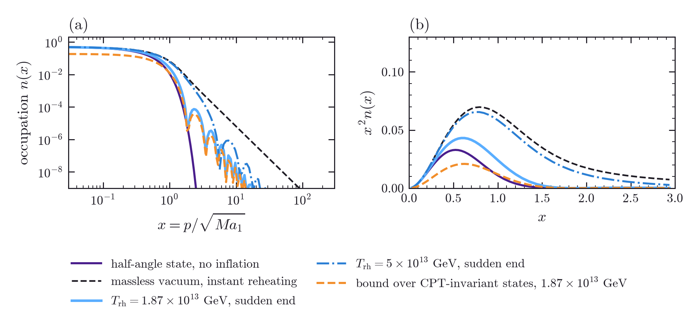
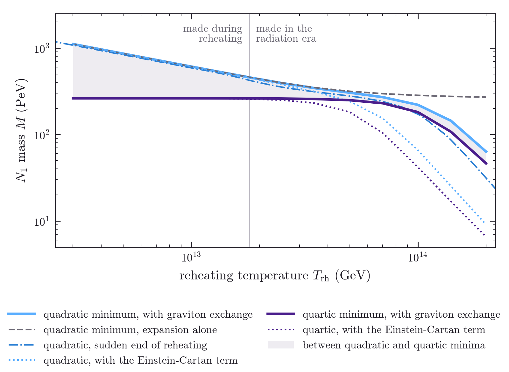
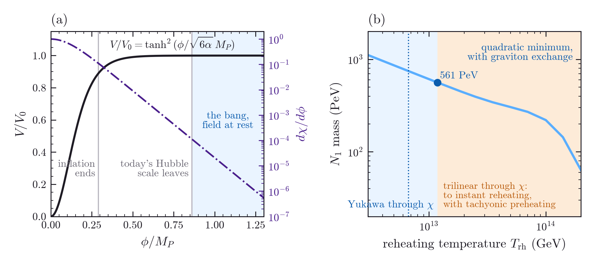

# Upside Down Inflation: dark matter and reheating after a CPT-symmetric bang

**B. H. Wiseman**

*Linnet Labs, Sydney, Australia (independent researcher; no external funding)*

---

## Abstract

Boyle, Finn and Turok proposed that the universe before the big bang is the CPT image of the one
after it, with no inflation, and that the dark matter is a right-handed neutrino $N_1$ made by the
expansion at the bang. Without inflation its mass is at most 491.6 PeV for every CPT-invariant state
[@SW6]. Here we add a period of inflation after the bang on each side. CPT symmetry makes a
homogeneous inflaton even in conformal time, so it starts at rest. With enough inflation to make the
observed perturbations, the choice of state at the bang drops out under the standard
assumption that modes far above the temperature start in their vacuum, and the reheating history sets
the mass, as for any purely gravitational Majorana fermion, provided the inflaton's Yukawa coupling to
$N_1$ is below about $M/20M_P$. We also locate where an analytic spectrum for this transition departs
from numerical ones. The inflaton must also survive the hot era before inflation and
still reheat. A T-model $\alpha$-attractor with $\alpha=0.0045$ supplies the perturbations at
$H_{\rm inf}=10^{12}$ GeV, with $r=1.6\times10^{-5}$ and $n_s=0.9655$. Coupled to matter through its
bounded field, it is shielded from the plasma before inflation, which moves it by $2.0\times10^{-5}M_P$.
A Yukawa coupling to a heavy fermion reheats it to at most $1.2\times10^{13}$ GeV, which puts the dark
matter at 561 PeV or heavier. A trilinear coupling to the Higgs through the same field reaches instant
reheating with the plateau intact, but meets tachyonic preheating. We close with a hypothesis, kept
apart from the rest: that expansion counts the formation of clocks.

## 1. Introduction

Boyle, Finn and Turok proposed that the universe before the big bang is the CPT image of the universe
after it [@BFTprl; @BFTann]. Near the bang the scale factor grows linearly in conformal time, the
radiation era runs back to the bang itself, and the dark matter is a right-handed neutrino $N_1$,
kept stable by a $\mathbb Z_2$ and made by the expansion, with a mass near 480 PeV. Their universe needs no inflation, though they
mention an inflationary neck at the bang as an option [@BFTann]. A companion paper showed that
without inflation no CPT-invariant state makes fewer $N_1$ than theirs, so that 491.6 PeV is a ceiling
on the mass, and corrected the rate at which graviton exchange in the plasma makes $N_1$ [@SW6].

Others have put inflation into CPT-symmetric pairs of universes. Chaichian, Gogberashvili,
Mnatsakanova and Tsiskaridze build a globally CPT-symmetric pair of coordinate-reversed universes,
each with an inflaton, and let local CPT violation set the baryon asymmetry [@CGMT]; Kumar creates a
flat universe-antiuniverse pair from nothing [@Kumar]. Here we keep Boyle, Finn and Turok's
radiation bang and add a period of inflation after it on each side, so that each side, read with
its own arrow of time pointing away from the bang, has the ordinary history of radiation,
inflation, reheating and radiation again.

Section 2 shows that the symmetry starts the inflaton at rest and sets out the history. Section 3
follows the dark matter through it: the choice of state drops out, the reheating history sets the
mass, and we locate the step at which an analytic spectrum for the transition [@HB] departs from the
numerical ones [@CEYZ], a disagreement its authors left open. That result assumes an inflaton that
rests on its plateau at the bang, survives the hot radiation era before inflation and still reheats.
Section 4 shows that couplings through the inflaton itself fail the middle requirement and builds an
inflaton that meets all three. Section 5 states a hypothesis, kept apart from the rest, about what
drives expansion.

## 2. The inflaton at the bang

### 2.1 CPT starts it at rest

Near the bang $a(\eta)=a_1\eta$, and Boyle, Finn and Turok relate the two sides by
$(\eta,\mathbf x)\mapsto(-\eta,-\mathbf x)$ together with charge conjugation [@BFTprl]. A real scalar
goes to $\phi(-\eta,-\mathbf x)$ under this map, so a homogeneous inflaton on a CPT-symmetric
background obeys $\phi(\eta)=\phi(-\eta)$. Its equation of motion near the bang,

$$
\phi''+\frac{2}{\eta}\,\phi'+a_1^2\eta^2\,V'(\phi)=0 ,
$$

has one solution regular at the bang and one that diverges as $1/\eta$. The regular one is even,

$$
\phi=\phi_0-\frac{a_1^2V'(\phi_0)}{20}\,\eta^4+O(\eta^8),
$$

so the inflaton is uniform and at rest at the bang, at whatever value $\phi_0$ it has there.
Regularity alone picks this solution on each side; CPT symmetry then makes the other side start from
the same $\phi_0$, at rest too. The symmetry does not fix
$\phi_0$; inflation needs it on the plateau, far enough out to give the observed number of e-folds.

### 2.2 History

We take inflation to last 58 e-folds or more, so that it also makes the observed
perturbations: today's Hubble scale left the horizon 58 e-folds before the end for
$H_{\rm inf}=10^{12}$ GeV and $T_{\rm rh}=1.87\times10^{13}$ GeV. The bang then lies far outside the
observable universe, and the inflaton supplies the scalar amplitude, which at $H_{\rm inf}=10^{12}$
GeV needs a slow-roll parameter $\epsilon=1.0\times10^{-6}$ and gives $r=1.6\times10^{-5}$.

Inflation removes what the plasma made before it. If it runs up to the reduced Planck temperature,
the plasma before inflation makes $N_1$ with yield $2.5\times10^{-5}$, $2.8\times10^{13}$ times the dark
matter, and inflation divides it by at least $e^{3N}$, so 12.6 e-folds bring it below a thousandth of
the dark matter. After inflation the plasma starts at $T_{\rm rh}$, so its yield is bounded, and the
expansion's can match it.

## 3. Dark matter after inflation

### 3.1 The state at the end of inflation

Near a radiation bang, $a=a_1\eta$, each mode of $N_1$ with comoving momentum $p$ crosses a two-level
gap, a Landau-Zener problem in $t=\sqrt{Ma_1}\,\eta$ with gap $2x$, $x=p/\sqrt{Ma_1}$. CPT invariance
leaves a family of states at the bang, with one free phase for each momentum, and Boyle, Finn and
Turok choose its least-excited member, the half-angle state; the in-vacuum is the adiabatic ground
state long before the crossing. The abundance depends on the state through
$I=\pi^{-1/2}\int_0^\infty x^2n(x)\,dx$, with $n$ the occupation after production, and the mass goes as
$I^{-2/5}$ [@BFTann; @SW6]. With $a_1$ the slope of the radiation era after reheating, the modes that
become dark matter have $x\sim1$. At the bang the same modes lie far above the comoving temperature of the plasma before
inflation: their crossing variable is larger by a factor $e^N(\rho_{\rm end}/\rho_{\rm rh})^{1/12}$,
which exceeds $10^6$ already at $N=12.6$, with $\rho_{\rm end}=3H_{\rm inf}^2M_P^2$ and
$\rho_{\rm rh}$ the radiation density at $T_{\rm rh}$. For these modes the bang's crossing is adiabatic, and the
in-vacuum, the out-vacuum and Boyle, Finn and Turok's half-angle state differ from the massless vacuum
by populations of order $1/(16x^4)$, $5\times10^{-26}$ at $x=1.06\times10^6$. During inflation the modes stay
relativistic, $Ma\ll p$, so the field is conformal and inflation neither excites nor relaxes them.
Boyle, Finn and Turok's state, which is Hadamard [@NNP], therefore reaches the end of inflation as the
massless vacuum on these modes, and the particles are made afterwards, once $H$ falls to $M$.

Other members of the family differ from Boyle, Finn and Turok's state by populations of these
modes, and quanta of these modes are energetic: their momentum is $\kappa\,x$ times the temperature, with
$\kappa$ about $10^{22}$ for 60 e-folds, so even at $8.4\times10^{14}$ GeV, where inflation starts, it lies
far above the Planck scale. We make the standard assumption that such trans-Planckian modes start in
their vacuum, imposed here as the condition that $N_1$ carries less energy than the
plasma before inflation [@KKLSS; @AMM]. The CPT symmetry plays no part in this step; the assumption removes the
choice of state from the calculation. Appendix A shows how much it removes. Two half-crossings
bracket the bang, ours and the mirror's, and their interference allows states that make about half as
many particles as the massless vacuum, but any population that changes production by ten per cent
carries more $N_1$ energy than the plasma once inflation lasts 12.7 to 14.1 e-folds (Table A.1), and
at 58 e-folds $10^{78}$ times as much. Below about 12 e-folds nothing fixes the state.

**Figure 1.** After inflation the dark-matter modes start the radiation era in the massless vacuum, and
the end of inflation and reheating shape their occupation. (a) Occupation after production and (b) the
integrand $x^2n$ of the production integral, against $x=p/\sqrt{Ma_1}$ with $a_1$ the slope of the
radiation era after reheating, for $H_{\rm inf}=10^{12}$ GeV. Black dashed: the massless vacuum, which
instant reheating gives, falling as $1/16x^4$. Blue: a sudden end of reheating at
$T_{\rm rh}=1.87\times10^{13}$ (solid) and $5\times10^{13}$ GeV (dash-dotted), whose junctions cause
the fringes; the end of inflation steepens the tail to $x^{-6}$ beyond $x\sim1/t_{\rm rh}$. Orange
dashed: the bound $\bar n_*$ of Appendix A at $1.87\times10^{13}$ GeV, averaged over the interference
phase. Purple: the half-angle state of the universe without inflation, for comparison.

{width=100%}

### 3.2 Production after inflation

From here the calculation is the standard one for gravitational production of a stable Majorana
fermion after inflation [@CKR; @KT99; @KT98; @CEYZ; @ENT18; @ENT; @HB; @KolbLong], and Boyle, Finn and Turok noted
that inflation turns their mass into a range [@BFTann]. We follow each mode through the end of
inflation, reheating and the radiation era (Appendix A, Fig. 1). For reheating we take the inflaton to decay
at a constant rate $\Gamma$, with $T_{\rm rh}$ defined by $\Gamma=H(T_{\rm rh})$ in the radiation era,
and we integrate the graviton-exchange yield of the companion paper [@SW6] along the temperature history, which rises above
$T_{\rm rh}$ during reheating, to $7.7\times10^{13}$ GeV when $T_{\rm rh}=1.87\times10^{13}$ GeV. The
mass solves $M\,(Y_{\rm exp}+Y_{\rm plasma})=\rho_{\rm DM,0}/s_0$, with
$Y_{\rm exp}\propto M^{3/2}I(M,T_{\rm rh})$, as Ema, Nakayama and Tang did for fermions and vector
bosons [@ENT].

The mass is set by the expansion when $H$ falls to $M$. When that expansion is radiation-like, as
for an inflaton oscillating in a quartic minimum, it is 261.8 PeV at every $T_{\rm rh}$ for
$H_{\rm inf}=10^{12}$ GeV. With radiation joined straight onto the end of inflation it is 269.4, 261.3
and 258.8 PeV for $H_{\rm inf}=10^{11}$, $10^{12}$ and $10^{13}$ GeV, since the radiation-like era then begins where the mass term is already
$(M/H_{\rm inf})^{1/2}$ in the variables of [@SW6]. When a matter-like reheating from a quadratic
minimum is still under way, the mass is higher: 449 PeV at $T_{\rm rh}=1.87\times10^{13}$ GeV, 1112
PeV at $3\times10^{12}$ GeV, and rising as $T_{\rm rh}^{-1/2}$ below, the scaling found for
production during reheating [@CEYZ; @ENT]. Graviton exchange lowers the mass where the plasma is
hot: for a quadratic minimum it makes 0.6 per cent of the abundance at $1.87\times10^{13}$ GeV, 8
per cent at $5\times10^{13}$ GeV and most of it above $1.05\times10^{14}$ GeV. At
$H_{\rm inf}=10^{12}$ GeV the mass therefore runs from $4.2\times10^5$ GeV, when reheating is
instant and the plasma at $8.4\times10^{14}$ GeV sets the abundance, up to about $H_{\rm inf}$,
which the $T_{\rm rh}^{-1/2}$ scaling reaches at $T_{\rm rh}$ near $3.7\times10^6$ GeV. There is no mass prediction;
Table 1 and Fig. 2 give benchmarks.

The benchmarks depend on the reheating model. A sudden end of reheating and a perturbative decay
differ by 3 to 10 per cent in the mass at the same $T_{\rm rh}$, between $1.2\times10^{13}$ and
$5\times10^{13}$ GeV, with the expansion alone, and along a perturbative history the plasma's yield
is 0.53 of the sudden formula at $T_{\rm rh}$, in line with Garcia et al. once their reheating
temperature, 0.82 of ours for the same $\Gamma$, is converted [@Garcia]. With a sudden end, the
scale of inflation moves the mass by at most 0.5 per cent between $H_{\rm inf}=10^{11}$ and
$10^{13}$ GeV, and at $10^{10}$ GeV it is 3 per cent higher at $T_{\rm rh}=1.87\times10^{13}$ GeV
and 10 per cent higher at $3\times10^{12}$ GeV. For a quartic minimum the inflaton's mass falls as
$1/a$, so its decay rate is not constant [@GKMO]; we take $T_{\rm rh}$ to be the radiation-era
temperature at which $H$ equals that rate. Decays to fermions slow down and trilinear decays to
bosons speed up, which moves the temperature above which graviton exchange makes
most of the dark matter from about $9\times10^{13}$ GeV for a constant rate to $3.1\times10^{13}$
and $1.1\times10^{14}$ GeV respectively. The condensate can also fragment [@LA]. None of this
changes the radiation-like mass of the expansion. The minimal Einstein-Cartan contact term [@SW6; @Shaposhnikov] moves the crossover for a quadratic
minimum from $1.05\times10^{14}$ to $5.2\times10^{13}$ GeV. Since other operators can only add to
the plasma's yield, in Einstein gravity the masses above $T_{\rm rh}\approx3\times10^{13}$ GeV are
upper bounds.

**Table 1.** With inflation there is no mass prediction: the mass follows the reheating temperature and the
shape of the inflaton's minimum. Benchmark $N_1$ masses against reheating temperature, for $H_{\rm inf}=10^{12}$ GeV,
rounded to 1 PeV. For perturbative reheating from a quadratic minimum, the second and third columns
are the expansion alone and with graviton exchange in the plasma, and the fourth is the plasma's
share of the abundance. The fifth is the mass with graviton exchange for a quartic minimum, where
reheating is radiation-like (constant decay rate), and the sixth for a quadratic minimum with a
sudden end of reheating.

| $T_{\rm rh}$ (GeV) | expansion (PeV) | with plasma (PeV) | plasma share | quartic (PeV) | sudden end (PeV) |
|---|---|---|---|---|---|
| $3\times10^{12}$ | 1112 | 1112 | 0.0% | 262 | 1077 |
| $8\times10^{12}$ | 681 | 681 | 0.1% | 262 | 659 |
| $1.2\times10^{13}$ | 558 | 557 | 0.2% | 262 | 540 |
| $1.87\times10^{13}$ | 451 | 449 | 0.6% | 261 | 413 |
| $2.5\times10^{13}$ | 396 | 393 | 1.3% | 260 | 353 |
| $3.5\times10^{13}$ | 348 | 343 | 3.1% | 257 | 312 |
| $5\times10^{13}$ | 316 | 304 | 8.0% | 249 | 278 |
| $7\times10^{13}$ | 296 | 270 | 19.3% | 230 | 240 |
| $1\times10^{14}$ | 283 | 220 | 45.2% | 181 | 172 |
| $1.4\times10^{14}$ | 275 | 144 | 79.3% | 107 | 86 |
| $2\times10^{14}$ | 270 | 63 | 97.2% | 46 | 31 |

{width=85%}

**Figure 2.** With inflation, the reheating temperature sets the dark-matter mass, and graviton exchange in
the plasma lowers it when reheating is hot. Benchmark $N_1$ masses against reheating temperature, $H_{\rm inf}=10^{12}$ GeV. Blue: perturbative reheating from a quadratic inflaton minimum, with graviton exchange in the plasma
integrated along the temperature history; grey dashed: the same with the expansion alone; blue dash-dotted: a sudden end of reheating. Purple: a quartic minimum, where reheating is radiation-like;
the shading spans the two minima. Dotted: the minimal Einstein-Cartan contact term added to graviton exchange, for the quadratic (blue)
and quartic (purple) minima. The vertical line marks where
$H(T_{\rm rh})=M$ for a quadratic minimum; to its left the particles are made during reheating.

### 3.3 A published analytic spectrum

Our sudden limit agrees with the closest numerical calculation to within 15 per cent. In the form
$na^3=C_MM^3a_M^3$, with $a_M$ the scale factor at $H=M$, it gives $C_M=I/\pi^{3/2}=0.0115$ for a
Majorana fermion, against 0.010 from the numerical result of Chung, Everett, Yoo and Zhou for an
abrupt transition from de Sitter to radiation, with the same $k^{-4}$ tail, determined for
$M<0.1H_{\rm inf}$; their $4\times0.005$ counts the four states of a Dirac fermion [@CEYZ]. Beltrán-Palau, Nadal-Gisbert, Navarro-Salas and Pla give $I=0.06305$ and
$2.6\times10^8$ GeV for the massless-vacuum state [@BNNP], which is our instant-reheating limit; their
integral is ours cut off near $x=31$, where the slowly falling tail still carries 2 per cent.

Herring and Boyanovsky's analytic treatment of the same transition gives the half-angle occupation
instead, $C_M=0.0023$, with a Gaussian tail, and they noted that they did not understand the
difference from Chung et al. [@HB]. Their matching is the same as ours, the massless spinor at the
end of inflation projected onto the radiation era's out states at $z=0$, and its exact evaluation
gives

$$
n_{\rm vac}(x)=\tfrac12\Bigl[1-\sqrt{1-e^{-\pi x^2}}\,\cos\vartheta(x)\Bigr],\qquad
\vartheta(x)=\tfrac\pi4+\arg\Gamma\bigl(\tfrac12+\tfrac{ix^2}4\bigr)-\arg\Gamma\bigl(1+\tfrac{ix^2}4\bigr),
$$

which reproduces our mode integration to four figures, $1/(16x^4)$ tail included; exact solutions of
Landau-Zener problems of this kind are in [@VG; @DZ]. Their Appendix C (arXiv v2) replaces the Gamma-function
phases by their large-argument form, which sets $\vartheta\to0$ and gives the half-angle formula, but
$\vartheta(0)=\pi/4$ and $\vartheta(1)=0.47$, so the approximation fails where the abundance is made; their
printed Eq. (III.41) also carries the out-state normalisation once where the projection needs it
squared. The difference with Chung et al. is that step.

### 3.4 Other couplings after inflation

The Higgs operator $(c_H/2\Lambda)\,\overline{N_1^c}N_1H^\dagger H$ of the companion paper [@SW6]
gives a bounded yield after inflation, linear in $T_{\rm rh}$: with $\Lambda=M_P$ it stays below a
tenth of the dark matter for $c_H<4.1\times10^{-5}$ at $T_{\rm rh}=1.87\times10^{13}$ GeV and
$c_H<2.6\times10^{-5}$ at $10^{14}$ GeV. Through a graviton
the inflaton condensate can annihilate to $N_1$ pairs, but the amplitude needs a helicity flip
and is suppressed by $(M/m_\phi)^2$ [@MO; @Clery]; for a quadratic minimum Clery et al.'s rate gives
under a tenth of a per cent of the dark matter for $m_\phi$ from $10^{13}$ to $3\times10^{13}$ GeV
and $H_{\rm inf}$ from $10^{12}$ to $10^{13}$ GeV; for a quartic minimum $m_\phi$ falls as $1/a$, so
the suppression weakens. A singlet inflaton can also couple to $N_1$ pairs directly,
$(y/2)\,\phi\,\overline{N_1^c}N_1$, which the $\mathbb Z_2$ allows. With
$\Gamma(\phi\to N_1N_1)=y^2m_\phi/16\pi$, a coupling of the size the Majorana mass suggests,
$y=M/M_P$, makes 40 times the dark matter at $T_{\rm rh}=1.87\times10^{13}$ GeV, and a branching
ratio above $3.5\times10^{-20}$ ($m_\phi=10^{13}$ GeV) makes more than a tenth of it. No symmetry of
the model forbids the coupling while letting the inflaton decay to the Standard Model, so we assume
$y<9.2\times10^{-12}\,(T_{\rm rh}/1.87\times10^{13}\,{\rm GeV})^{1/2}(449\,{\rm PeV}/M)^{1/2}$,
which does not depend on $m_\phi$ and is $0.05\,M/M_P$ at the reference point, just as we assumed the
Higgs operator small.

## 4. An inflaton that survives the hot era

### 4.1 Couplings through the inflaton itself

The inflaton has to stay on its plateau through the radiation era before inflation, which begins near
the Planck temperature, and still reheat the universe afterwards, though a coupling strong enough to reheat can move it off the plateau in that hot era. A Yukawa coupling to fermions that reheats
to $1.87\times10^{13}$ GeV from $m_\phi=10^{13}$ GeV needs $y=0.035$, and gives the inflaton a thermal
mass of $1.2\times10^{13}$ GeV, 12 times $H_{\rm inf}$, when the plasma at $8.4\times10^{14}$ GeV meets
the plateau, unless the fermions are heavier than the temperature there. The thermal mass exceeds the Hubble rate below $1.0\times10^{16}$ GeV, so keeping the fermions heavier
than the temperature needs $y\phi$ above that, and their one-loop energy, $(y\phi)^4/16\pi^2\approx6.9\times10^{61}$ GeV$^4$, would then exceed the plateau's
$1.8\times10^{61}$ GeV$^4$. A trilinear coupling to the Higgs barely moves the inflaton: at the largest coupling whose one-loop
slope stays below the plateau's, the plasma shifts it by 0.4 per cent of $M_P$ in total, and that coupling reheats perturbatively to at most about $3\times10^{13}$ GeV, for $\phi\sim M_P$ and
$m_\phi=10^{13}$ GeV. Benchmarks with reheating above that temperature need an inflaton whose couplings
are suppressed on the plateau.

The perturbative estimate leaves out preheating:
after inflation the trilinear coupling makes the Higgs tachyonic for part of each oscillation, which
can complete preheating within a few oscillations [@DFKPP] and, outside a window of Higgs-inflaton
couplings, destabilise the electroweak vacuum [@EKLRZ]. Section 3 used only the plateau's height and slope and the mass at the minimum. The rest of this
section builds an inflaton with those properties whose couplings are suppressed on the plateau.

### 4.2 An $\alpha$-attractor

The T-model $\alpha$-attractor [@KL13; @KLR13] has

$$
V=V_0\tanh^2\frac{\phi}{\sqrt{6\alpha}\,M_P},
$$

a plateau at large $\phi$ and a quadratic minimum at zero. In slow roll, with
$u=\phi/\sqrt{6\alpha}\,M_P$, the first slow-roll parameter is $\epsilon=4/(3\alpha\sinh^22u)$ and the
number of e-folds to the end of inflation is $N=(3\alpha/4)(\cosh2u-\cosh2u_{\rm end})$, inflation
ending where $\epsilon=1$. Section 2.2 needs $\epsilon=1.0\times10^{-6}$ at 58 e-folds, which with
the observed amplitude puts the plateau at $H_{\rm inf}=10^{12}$ GeV. That fixes $\alpha=0.0045$,
and then $r=1.6\times10^{-5}$, $n_s=0.9655$, and the mass at the minimum is
$m_\phi=H_{\rm inf}/\sqrt\alpha=1.5\times10^{13}$ GeV. Today's Hubble scale leaves the horizon at
$\phi=0.86\,M_P$, and inflation ends at $0.29\,M_P$ (Fig. 3a).

The spectral index agrees with Planck's $0.965\pm0.004$ [@Planck] and lies $2.8\sigma$ below the
$0.974\pm0.003$ of ACT's combination with Planck, lensing and baryon acoustic oscillations [@ACT]. If
that value holds, $\alpha$-attractors at 58 e-folds are disfavoured. Nothing below depends on the
spectral index, only on the plateau's height and slope and the mass at the minimum, so an inflaton
with a larger $n_s$ at the same $r$ would serve as well.

The plateau runs on without limit, so the bang may sit anywhere beyond $0.86\,M_P$. Between the bang
and the start of inflation the plateau's slope moves the field only $1.6\times10^{-4}M_P$ from
$0.86\,M_P$, 0.11 e-folds; the field waits while the radiation thins. Inflation starts when the
radiation's energy falls to the plateau's, at a temperature of $8.4\times10^{14}$ GeV.

**Figure 3.** (a) The T-model potential (black), with the field values where inflation ends and
where today's Hubble scale leaves the horizon, and the range where the bang may sit with the field
at rest (blue). Purple, right axis: $d\chi/d\phi$, the factor by which the bounded field shields the
plateau from anything coupled to it. (b) The $N_1$ mass against the reheating temperature for a
quadratic minimum, with graviton exchange in the plasma (blue line), as in Fig. 2. Blue: the reach of a Yukawa coupling through $\chi$, to $1.2\times10^{13}$ GeV (dot), and to
$6.7\times10^{12}$ GeV with the loop held to a tenth of $V_0$ (dotted). Orange: the further reach of a trilinear
Higgs coupling through $\chi$, up to instant reheating.

### 4.3 Shielded from the plasma

The plasma before inflation runs from near the Planck temperature down to $8.4\times10^{14}$ GeV, and
any coupling that later reheats the universe lets it push on the inflaton first. A Yukawa coupling
through the inflaton itself, strong enough to reheat to $1.87\times10^{13}$ GeV, gives the inflaton a
thermal mass twelve times $H_{\rm inf}$ when the plasma meets the plateau (Section 4.1), which pulls
the field off its plateau before inflation can start.

The $\alpha$-attractor offers a way round this. In its superconformal construction the potential is
a function of a field with a pole in its kinetic term [@KLR13], the bounded field

$$
\chi=\sqrt{6\alpha}\,M_P\tanh\frac{\phi}{\sqrt{6\alpha}\,M_P},
$$

and we let matter couple to the same field. On the plateau $\chi$ hardly changes:
$d\chi/d\phi=\mathrm{sech}^2u$ is $1.2\times10^{-4}$ at $0.86\,M_P$ and falls by $e^{-2}$ for each further
$\sqrt{6\alpha}\,M_P=0.16\,M_P$ (Fig. 3a). A coupling $y\chi\bar\psi\psi$ to a heavy Dirac fermion
$\psi$ then pushes on the inflaton with

$$
\frac{\partial F}{\partial\phi}=\frac{T^2}{\pi^2}\,K\!\left(\frac{m}{T}\right)2m\,\frac{dm}{d\phi},\qquad
m=y\chi,\qquad K(z)=\int_0^\infty\frac{x^2\,dx}{E\,(e^E+1)},\quad E=\sqrt{x^2+z^2},
$$

the derivative of the fermions' free energy, and $dm/d\phi=y\,\mathrm{sech}^2u$ shields the push by
the same factor. We follow the field from the reduced Planck temperature, at rest at $0.86\,M_P$, the
start nearest the minimum, through the moment the plasma meets the plateau and on into inflation,
once with this force and once without. At the largest coupling Section 4.4 allows, $y=0.0182$, the plasma moves the field $2.0\times10^{-5}M_P$,
which shortens inflation by 0.014 e-folds, and the curvature it adds
never exceeds $1.7\times10^{-4}H^2$. The same coupling through $\phi$ itself, with the fermions light,
drags the field from 0.86 to $0.08\,M_P$ before inflation could begin.

### 4.4 Reheating, and how hot

Near the minimum $\chi\approx\phi$, so the inflaton decays to $\psi$ pairs at $\Gamma=y^2m_\phi/8\pi$.
Reheating ends when the Hubble rate of the radiation era falls to $\Gamma$, at
$T_{\rm rh}=y\times6.5\times10^{14}$ GeV, and $\psi$ passes its energy on to the Standard Model. It can be, for example, a vector-like lepton
with a small Yukawa coupling to the Higgs and a Standard Model lepton, through which it decays; that
coupling keeps $\psi$ in the plasma before inflation without touching the inflaton, whose own coupling
stays shielded.

The coupling cannot be large, because $\psi$ also changes the potential. Its one-loop potential
[@CW73], $-(4/64\pi^2)\,m^4[\ln(m^2/\mu^2)-3/2]$ with $m=y\chi$, is $-c\,x^4\ln x^2$ in
$x=\tanh(\phi/\sqrt{6\alpha}\,M_P)$, with $c=(y\sqrt{6\alpha}\,M_P)^4/16\pi^2$, plus a quartic that a
counterterm absorbs. We fix the counterterms so that the plateau's height, which the observed
amplitude sets, and the mass at the minimum keep their values; the loop then adds $c\,x^4|\ln x^2|$ to
$V_0x^2$, zero at both ends. The slope of the sum is $2x[V_0-c\,x^2(2\ln x^2+1)]$, and
$x^2(2\ln x^2+1)\le1$ for $x\le1$, so the potential rises all the way to its plateau only while
$c<V_0$. That allows $y$ up to 0.0182, where $T_{\rm rh}=1.2\times10^{13}$ GeV; holding $c$ to a tenth
of $V_0$ gives $y=0.0102$ and $T_{\rm rh}=6.7\times10^{12}$ GeV. This inflaton, with this coupling,
reheats to at most $1.2\times10^{13}$ GeV, below the reference point of Section 3, $1.87\times10^{13}$ GeV.

These are perturbative estimates. Resonant production of the fermions can change them [@BCGMP],
but a fermionic channel gives the Higgs no tree-level coupling to the inflaton, so the tachyonic
preheating that troubles trilinear couplings [@DFKPP; @EKLRZ] does not arise.

Hotter reheating needs another coupling. The trilinear coupling to the Higgs of Section 4.1, moved
onto the bounded field as $\mu\chi H^\dagger H$, loses the limit it had there, because its one-loop
slope on the plateau is shielded by $\mathrm{sech}^2u$ like everything else. Instant reheating, at
$8.4\times10^{14}$ GeV, needs $\mu=1.9\times10^{13}$ GeV. There the Higgs loop's energy on the plateau
is 3.2 per cent of the plateau's and its slope 2.1 per cent of the tree-level slope, and the plasma
before inflation moves the field $7.2\times10^{-6}M_P$. What this coupling cannot escape is the
oscillation after inflation: whenever $\chi<0$ the Higgs is tachyonic, which can complete preheating
within a few oscillations [@DFKPP] and, outside a window of Higgs-inflaton couplings, destabilise
the electroweak vacuum [@EKLRZ]. Whether that window holds the couplings needed here is the open
question for hotter reheating.

### 4.5 The dark-matter mass

For a quadratic minimum and perturbative reheating, Table 1 gives the $N_1$ mass at each
reheating temperature. This inflaton, reheating through $\psi$, gives 1112 PeV at
$3\times10^{12}$ GeV, 681 PeV at $8\times10^{12}$ GeV, and 561 PeV at its limit of $1.2\times10^{13}$ GeV (Fig. 3b), or 747 PeV with $c$ held to a tenth of
$V_0$. With this coupling the dark matter therefore weighs 561 PeV or more, above the 491.6 PeV that bounds it
without inflation [@SW6]. Lighter dark matter needs hotter reheating, which here means the trilinear
route and its preheating question. With 58 or more e-folds, inflation predicts primordial
tensor modes, $r=1.6\times10^{-5}$ at $H_{\rm inf}=10^{12}$ GeV, where the universe without inflation
predicts none [@BFTann], but far below the reach of planned experiments.

## 5. A hypothesis: expansion as clock formation

Sections 2 to 4 are standard physics. This section states a hypothesis of the author's, and nothing
in them depends on it.

The hypothesis is that the expansion of the universe counts the formation of clocks, physical
records that order events in time, so that more clocks means more time and, with space and time
joined, more space. It has a natural reading during inflation. Each mode of a light field that
leaves the horizon freezes and decoheres into an effectively classical record of its amplitude
[@PS96; @KP09], and in de Sitter space the rate at which that happens is fixed. Modes leave when
their comoving wavenumber reaches $aH$. With $k^3/6\pi^2$ modes per comoving volume below $k$, the rate
per physical volume is $H^4/2\pi^2$, which is $2/3\pi\approx0.21$ new records per Hubble volume per
Hubble time for each degree of freedom, whatever $H$ is. A universe whose expansion is set by its rate
of record formation would therefore expand steadily while records form steadily, which is what
inflation does, and would stop when the supply of freezing modes runs out.

The reading is only consistent with inflation. Because $2/3\pi$ holds for every $H$, it does not fix the
rate of inflation, and we have no law that turns a rate of record formation into a Hubble rate
with a coefficient fixed elsewhere; until there is one, the hypothesis predicts nothing. One test
exists, and it failed. In a late-time version the dark energy grows in proportion to the stars
formed so far [@MD14], with no free parameter. It raises the Hubble constant inferred from the
cosmic microwave background by 9.8 per cent, but distances refuse it, by 83.5 in $\chi^2$ against
DESI's second-release baryon acoustic oscillations [@DESIBAO] and the Pantheon+ supernovae [@PPlus],
and a free amplitude does not rescue it (an unpublished test, registered before it met the data).
Inflation is a different regime, and the reading above is where the idea would have to start.

## 6. Conclusions

Inflation fits after a CPT-symmetric radiation bang. The symmetry starts a homogeneous inflaton at
rest, and with inflation after the bang it no longer acts on the dark matter. Under the standard
assumption that trans-Planckian modes start in their vacuum the choice of state drops out; at 58
e-folds a state that changed production by ten per cent would carry $10^{78}$ times the plasma's
energy. As for any Majorana fermion coupled only through gravity, the reheating history sets the mass
(Fig. 2, Table 1), from $4.2\times10^5$ GeV up to about $H_{\rm inf}$, and near 260 PeV when the
expansion at $H=M$ is radiation-like. Along the way we located the step behind Herring and
Boyanovsky's half-angle spectrum, which resolves their disagreement with Chung et al.

These results assume an inflaton that stays on its plateau through the hot era before inflation and
still reheats, with its couplings suppressed on the plateau if reheating exceeds about $3\times10^{13}$
GeV. They also assume that its Yukawa coupling to $N_1$ is at most a twentieth of what the Majorana
mass suggests, about $M/20M_P$, and a Higgs operator no larger than that mass suggests. A T-model
$\alpha$-attractor with $\alpha=0.0045$, coupled through its bounded field, sits out the hot era almost
untouched, and a Yukawa coupling to a heavy fermion reheats it to $1.2\times10^{13}$ GeV, which puts
the dark matter at 561 PeV or more. Hotter reheating, and lighter dark matter, turn on whether a
trilinear Higgs coupling can preheat without destabilising the electroweak vacuum. After inflation the
CPT universe keeps its candidate and its massless lightest neutrino, and reheating sets the mass.

## Appendix A. Modes through inflation

*Numerics.* `v6_reheating_production.py` integrates $i\partial_t\psi=(m(t)\sigma_z+x\sigma_x)\psi$
with an eighth-order Runge-Kutta method (relative tolerance $10^{-10}$), starting each mode in the
instantaneous ground state deep in inflation, at $t\le-5$ and where $m\le0.02x$ and
$m'\le10^{-6}x^2$, and ending where $t\ge\max(40,6x,4t_{\rm rh}+20)$, where it projects onto the
adiabatic excited state. The condition on $m'$ matters: the instantaneous ground state misses the
evolved state by an amplitude of about $m'/2x^2$, which later interferes with the production
amplitude, and without that condition the mass at $T_{\rm rh}=3\times10^{12}$ GeV moves by 0.5 per
cent for $H_{\rm inf}=10^{11}$ GeV. A start where $m'\le10^{-9}x^2$ changes $I$ by under $10^{-6}$
(`v6_start_check.py`). For $x\le6$ it uses 97 modes; beyond, first-order adiabatic perturbation
theory gives $n=|\tilde m'(2x)|^2/4x^2$, with $\tilde m'$ the Fourier transform of $m'(t)$, which we
evaluate in closed form in the radiation and reheating segments and by oscillatory quadrature in the
de Sitter one. The checks: a full sweep reproduces $P=e^{-\pi x^2}$ and $I_{\rm in}=1/(4\pi^{3/2})$;
the half-angle formula gives $I_*$ to $10^{-10}$; at $x=6$ the first-order tail matches the exact
solution within 5 per cent and the Fourier formula within 3 per cent for fast transitions; for slow
transitions the tail beyond $x=6$ carries under 1 per cent of $I$, a test the sudden limit, whose
tail carries 9.1 per cent, fails as it should. `v6_mass_with_bath.py` solves for the mass with a
sudden end of reheating on 38 reheating temperatures and four variants, and with `--ceiling` for the
bound over all invariant states.

*Perturbative reheating.* `v6_reheating_smooth.py` and `v6_mass_smooth.py` solve
$\dot\rho_\phi=-3H\rho_\phi-\Gamma\rho_\phi$ and $\dot\rho_r=-4H\rho_r+\Gamma\rho_\phi$ from the end of
inflation, with de Sitter before it, read $a_1$ and the origin of conformal time off the late
radiation era, and hand the mode solver $m(t)=\sqrt{M/a_1}\,a$ by spline interpolation. The
graviton-exchange yield is integrated alongside, with $T^4=30\rho_r/\pi^2g_*$. A decay within two
Hubble times of the end of inflation reproduces the sudden model's mass to half a per cent, and its
plasma yield is 0.84 of the sudden formula evaluated at the highest temperature reached; both are
checks the code must pass. The perturbative grid covers 12 reheating temperatures.

*Two half-crossings.* Other members of the family behave differently from the massless vacuum.
Two half-crossings bracket the bang, ours and the mirror's, separated by a long massless stretch in
which the two massless levels acquire a relative phase $2\Phi$, with $\Phi$ of order $x\,e^N$. The
massless vacuum gives the same late occupation $n_{\rm vac}(x)$ whatever $\Phi$ is. A state with
population $p_e$ in the upper massless level and a phase unrelated to $\Phi$ gives
$n_{\rm vac}+p_e(1-2n_{\rm vac})$ once the rapid variation of $\Phi$ with $x$ averages the interference
away, so it makes more particles; a state whose phases follow $\Phi$ can make fewer. The companion
paper's bound over CPT-invariant states [@SW6] still applies to the whole evolution, and now it
oscillates. For the in-vacuum
$P=4n_{\rm vac}(1-n_{\rm vac})\sin^2(\Phi+\phi_0)$, the Stückelberg interference of two passages
[@SAN], and $n_*=(1-\sqrt{1-P})/2$ averages over $\Phi$ to

$$
\bar n_*=\tfrac12\Bigl[1-\tfrac2\pi E\bigl(4n_{\rm vac}(1-n_{\rm vac})\bigr)\Bigr]\approx\tfrac12\,n_{\rm vac},
$$

with $E$ the complete elliptic integral of the second kind. Boyle, Finn and Turok's criterion, least
particle number and energy, then has two readings: applied at the bang, where the symmetry is imposed,
it picks the half-angle state of the bang's own crossing, which for these modes is the massless
vacuum; applied to particle number at late times, it picks the state that reaches $\bar n_*$. Without
inflation the two coincide. At fixed $T_{\rm rh}$ the state that reaches $\bar n_*$ gives a mass up to
44 per cent higher. `v6_state_at_bang.py` finds the transfer matrix of our half-crossing from the
massless levels to the late adiabatic levels, and of the mirror's from the early adiabatic levels to
the massless ones, and joins them with an exactly massless stretch. Over a period of the joining phase
the in-vacuum occupation runs from zero, to the resolution of the phase grid, to
$4n_{\rm vac}(1-n_{\rm vac})$, and the phase average of $(1-\sqrt{1-P})/2$ equals the elliptic formula
to $10^{-3}$ at $x=0.6$ and 1.2; dropping the factor $1-n_{\rm vac}$ fails the comparison. At fixed
$t_{\rm rh}$ the bound halves production; at fixed $T_{\rm rh}$ the heavier mass also delays production,
which is why the mass ratio exceeds $2^{2/5}$.

*Energy at the bang.* The assumption of Section 3.1 limits how far a state can move production
through the energy its populations carry. With $p_e(x)$ the population of the upper massless level at the bang, measured
from Boyle, Finn and Turok's Hadamard state, which on the dark-matter modes differs from the
massless vacuum by $1/16x_b^4\lesssim10^{-25}$ and so leaves every entry below unchanged, the
population that reaches $\bar n_*$ is $\sin^2[\frac12\arctan(|\cos\theta|\tan2\beta)]$ with
$\sin^2\beta=n_{\rm vac}$, averaged over the interference phase $\theta$. With phases tuned to the
history, a population $p_e$ at a mode whose interference phase has $|\cos\theta|=c$ changes the
occupation by $\pm2c\sqrt{p_e(1-p_e)n_{\rm vac}(1-n_{\rm vac})}+p_e(1-2n_{\rm vac})$, the upper sign
raising it, and the least population that changes production by ten per cent chooses $p_e$ for each
mode and phase to maximise the change less a multiple of the energy. Only the second term survives for
random phases, and the least population that raises production fills modes in order of
$(1-2n_{\rm vac})/x$. Their energy relative to the plasma is
$(30/\pi^4g_*)\,\kappa^4\int_0^\infty x^3p_e\,dx$, with
$\kappa=\sqrt{\pi M\sqrt{g_*/15}/\mu}\;e^N(\rho_{\rm end}/\rho_{\rm rh})^{1/12}$; the ratio is
constant through the massless stretch, so it can be imposed at the onset of inflation as well as at
the bang. A population that reaches $\bar n_*$ needs $\int x^3p_e\,dx$ between $1.3\times10^{-2}$
and $4.9\times10^{-2}$; one whose phases follow the later history needs $1.0\times10^{-4}$ to
$4.1\times10^{-4}$ to change production by ten per cent either way, against $1.6\times10^{-3}$ to
$6.6\times10^{-3}$ to raise it with random phases. The energy goes as $e^{4N}$, so the largest
change in production the condition allows falls as $e^{-2N}$: at 15 e-folds it is 0.1 to 1.8 per
cent over these ranges. The e-folds above which each exceeds the plasma's energy at the bang,
computed with a sudden end of reheating for $H_{\rm inf}$ from $10^{10}$ to $10^{13}$ GeV and
$T_{\rm rh}$ of $1.87\times10^{13}$ and $5\times10^{13}$ GeV, are 11.5 to 12.9 for the state that reaches $\bar n_*$, 12.0 to 13.4 for random phases and 12.7
to 14.1 for tuned phases either way (Table A.1). At 8 e-folds none does, so the comparison can fail.

**Table A.1.** E-folds of inflation above which $N_1$ at the bang carries more energy than the plasma,
for the state that reaches $\bar n_*$ and for the least populations that change production by ten
per cent.

| $H_{\rm inf}$ (GeV) | $T_{\rm rh}$ (GeV) | reaches $\bar n_*$ | 10% more, random phases | 10% more, tuned phases | 10% less, tuned phases |
|---|---|---|---|---|---|
| $10^{10}$ | $1.87\times10^{13}$ | 12.7 | 13.2 | 13.9 | 13.8 |
| $10^{12}$ | $1.87\times10^{13}$ | 11.9 | 12.3 | 13.1 | 13.1 |
| $10^{13}$ | $1.87\times10^{13}$ | 11.5 | 12.0 | 12.7 | 12.7 |
| $10^{10}$ | $5\times10^{13}$ | 12.9 | 13.4 | 14.1 | 14.1 |
| $10^{12}$ | $5\times10^{13}$ | 12.1 | 12.6 | 13.3 | 13.3 |
| $10^{13}$ | $5\times10^{13}$ | 11.7 | 12.2 | 13.0 | 12.9 |

## Code and data

Every number in this paper comes from one of these scripts, in Python 3.12 with numpy, scipy, mpmath
and matplotlib: `v6_bath.py`, `v6_reheating_production.py`, `v6_mass_with_bath.py`,
`v6_reheating_smooth.py`, `v6_mass_smooth.py`, `v6_hinf.py`, `v6_instant.py`, `v6_start_check.py`,
`v6_hb_check.py`, `v6_state_at_bang.py`, `v6_quartic_decay.py`, `v6_trilinear_bath.py` and
`v6_alpha_inflaton.py`, which builds the model of Section 4 and runs its checks. `fig_inflaton.py`
draws the figures from their output, `mass_table.py` prints Table 1 from the mass tables the solvers
write, and `inflaton_check.py` compares each number in the text with the script that produces it.
Each script carries known-bad inputs that it must reject. All are in the code release of the
companion paper [@code], whose working repository is <https://github.com/BenWiseman/separate-ways>.

**AI disclosure.** The author originated the central ideas, directed the work, and is responsible
for the writing, claims, and decisions in this paper. Anthropic's Claude Opus 5.5 was used under the
author's direction to edit drafts, format references, write and revise the numerical and graphical
code, search the literature, and run fact and consistency checks; MiniMax-M3 and DeepSeek were used
as independent readers. These are large language models; nothing a model proposed was kept until it
had been redone in a script or checked against a source, and no model is an author.

## References
