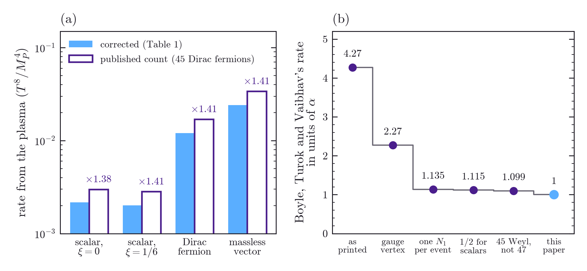
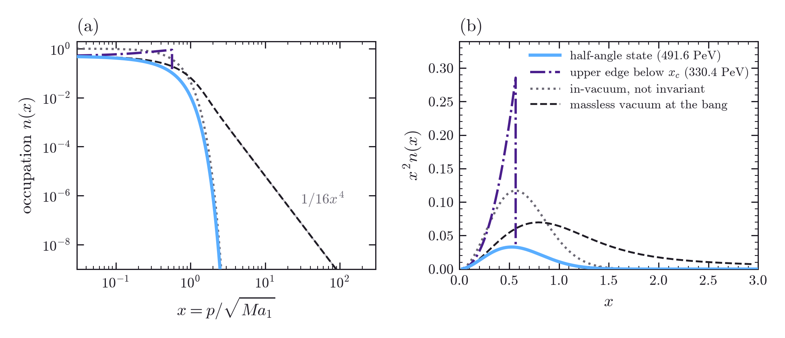

# Separate Ways and the Upside Down: corrected graviton-exchange rates and the dark matter of a CPT-symmetric universe

**B. H. Wiseman**

*Linnet Labs, Sydney, Australia (independent researcher; no external funding)*

---

## Abstract

Boyle, Finn and Turok proposed that the universe before the big bang is the CPT image of the one
after it, with right-handed-neutrino dark matter $N_1$ made at a radiation bang, near 480 PeV. A line of published graviton-exchange rates counts the Standard Model's 45 Weyl fermions as Dirac fermions, which
by itself makes the coefficients 1.41 times too large for fermion dark matter and 1.38 times for a
minimally coupled scalar; Tang and Wu count the fermions correctly. We give corrected coefficients for
scalar, fermion and vector dark matter, $1.20\times10^{-2}\,T^8/M_P^4$ for a Majorana fermion, and set
each published rate beside ours, equation by equation. Boyle, Turok and Vaibhav's Einstein-limit rate,
rebuilt from their equations, is 4.27 times ours, 3.8 of it from errors, but their finding stands: in Einstein gravity a
plasma that ever reached $8.0\times10^{13}$ GeV makes all the dark matter and sets the mass. If $N_1$
crosses the bang freely, every CPT-invariant state, mixed or correlated, makes at least as many as
Boyle, Finn and Turok's, so without inflation or entropy release their 491.6 PeV bounds the mass from
above; their state reaches the bound only where the plasma makes little $N_1$, as in quadratic gravity
with small Weyl coupling, and the symmetry sets no floor. A semiclassical, unquantised metric, a contested hypothesis, would
also remove the plasma's channel. If $N_1$ decays, its neutrino line lies at or below 245.8 PeV; with
the lightest neutrino massless the masses sum to 58.8 meV in normal ordering.

## 1. Introduction

Boyle, Finn and Turok proposed that CPT is a symmetry of the universe as a whole and not only of its
laws [1,2]. The universe before the big bang is then the CPT image of the universe after
it, and the state of every quantum field at the bang must be invariant under the map that relates
them. In the Standard Model with three right-handed neutrinos, a $\mathbb Z_2$ under which one of
them, $N_1$, is odd removes its Yukawa couplings, so $N_1$ is stable, has no renormalisable coupling
to the Standard Model, and can be the dark matter. The expansion makes it as each mode crosses from
one side of the bang to the other, and the observed abundance then fixes its mass at
$4.8\times10^8$ GeV, 480 PeV. With $N_1$ decoupled, only two right-handed neutrinos give the light neutrinos
mass, so one light neutrino is massless at tree level. Their universe has no inflation [2]. Our
test of that mass against the hot plasma found that a line of published graviton-exchange rates
counts the Standard Model's fermions twice, an error that carries over to any dark matter coupled
only through gravity; Tang and Wu count them correctly [3].

That mass can move. CPT invariance does not fix the state at the bang: it leaves a family, and
Boyle, Finn and Turok choose its least-excited member [2]; Nadal-Gisbert, Navarro-Salas and
Pla, who derived the same family, prefer a member that minimises the energy around the bang itself
[4]. And graviton exchange between particles of the plasma
makes $N_1$ pairs at a rate that grows faster with temperature than the expansion rate does, while a
radiation bang has no highest temperature. Boyle, Turok and Vaibhav pointed out that in Einstein
gravity this overproduces the dark matter, and they turn to quadratic gravity, which suppresses the production [5].
If the metric is not quantised and follows only the mean stress-energy, as semiclassical gravity
holds, the plasma makes no $N_1$ this way (Section 5); that hypothesis is contested, and its version
without collapse of the state is excluded by experiment [6].

Section 2 calculates the plasma's rate from the helicity sums, traces the double count through the
published rates [7-9], gives corrected coefficients for scalar, fermion and vector
dark matter, and locates where Boyle, Turok and Vaibhav's estimate departs from ours; Appendix C sets
each published rate beside ours, equation by equation. Section 3 sets out the bang and the states CPT
allows there. Section 4 shows that no invariant state, mixed or correlated across modes, makes fewer
particles than the least-excited one, so that without inflation the mass Boyle, Finn and Turok found is
a ceiling. Section 5 applies the corrected rate to the bang, and Section 6 lists what can be observed.
If a period of inflation follows the bang instead, the choice of state drops out and the reheating
history sets the mass, as for any purely gravitational Majorana fermion; a separate paper works that
case out [10].

We work in metric general relativity on a flat $\Lambda$CDM background, with the contact term of the
Einstein-Cartan formulation as the one alternative we quantify, and take $N_2$ and $N_3$ to be
absent from the plasma.

## 2. Graviton exchange in the plasma

Graviton exchange between Standard Model particles produces $N_1$ pairs [3,7,11]. We
calculate the rate in metric general relativity, with $\mathcal L=-h_{\mu\nu}T^{\mu\nu}/M_P$ for a
canonically normalised $h$, $g_{\mu\nu}=\eta_{\mu\nu}+2h_{\mu\nu}/M_P$, with $M_P=2.435\times10^{18}$ GeV
the reduced Planck mass, and the de Donder propagator, from explicit
helicity spinors and polarisation vectors, with Bose-Einstein and Fermi-Dirac distributions in the
initial state and final-state statistics neglected, since the $N_1$ occupation stays far below one (Appendix B). Most published rates differ from ours in how they count the fermions, and some in more
(Appendix C). A Dirac field is two degenerate Majorana fields, $\psi=(N_a+iN_b)/\sqrt2$, each a copy of
$N_1$, and its stress tensor is the sum of theirs with no cross term. The rate of Dirac-pair events is
therefore twice the rate of $N_aN_a$ pairs, each of which holds two $N_a$, so the number of Majorana
$N_1$ made per unit volume and time equals the rate of Dirac-pair events,

$$
\frac{dn_{N_1}}{dt}=R_{\rm Dirac\ pairs},
$$

with $R_{\rm Dirac\ pairs}$ the event rate of a Dirac fermion of the same mass.

And a Weyl fermion carries half the spin sum of a Dirac pair, so the Standard Model's 45 Weyl
fermions count as

$$
N_{\rm Dirac}=\tfrac12N_{\rm Weyl}=22.5 .
$$

For massless fermions $\psi_D=\psi_L+\psi_R$ and $T^{\mu\nu}_D=T^{\mu\nu}_L+T^{\mu\nu}_R$, with no
interference between the two, and the rate sums $\sum|\mathcal M|^2$ over the internal states it counts
with per-state occupations. In helicity terms, a massless Weyl field gives one particle and
antiparticle of opposite helicity, the one combination the graviton couples to, so 45 Weyl fields give 45 coupled combinations; a Dirac
field gives four combinations, two of them coupled, so 22.5 Dirac fields give the same 45, and 45
Dirac fields give 90. The same count follows from energy densities. For massless isotropic
distributions each pair of single-particle states adds $A\rho_a\rho_b/(24\pi^2M_P^4)$ to the rate, with $\rho$
the energy density of one state and $A$ the pair's angle-integrated squared amplitude, so the fermions
add $45(\pi/10)\rho_f^2/(24\pi^2M_P^4)$, with $\rho_f=\tfrac78(\pi^2/30)T^4$ the energy density of one of the
90 fermionic states that $g_*=106.75$ counts; 45 Dirac fermions would carry 180.

For $N_{\rm s}$ real scalars, $N_{\rm f}$ Weyl fermions and $N_{\rm v}$ gauge bosons in the plasma this gives

$$
\frac{dn_{N_1}}{dt}=\alpha\,\frac{T^8}{M_P^4},\qquad
\alpha=\pi^3\Bigl(\frac{N_{\rm s}}{648000}+\frac{49\,N_{\rm f}}{13824000}+\frac{N_{\rm v}}{54000}\Bigr)=1.20\times10^{-2}
$$

for the Standard Model's 4, 45 and 12.

A line of published rates counts the fermions twice. Garny et al. introduced the decomposition
into 4 real scalars, 45 Weyl fermions and 12 gauge bosons [11], and in their later paper sum
the squared amplitude over both spins of each incoming fermion and multiply by 45, in their Eq. (3.1)
[7]. Bernal et al. do the same in their Eq. (8) [8], as do Clery et al. in their
Eqs. (A1) and (A12) [9]; Tang and Wu count 22.5 [3]. With 45 Dirac fermions our sums give
$11351\pi^3/20736000=1.697\times10^{-2}$ per event, 1.41 times $\alpha$, and Clery et al.'s Eq. (A12)
is exactly twice that, since their rate counts the two particles each event makes; for a minimally coupled real scalar their Eq. (A8), $3997\pi^3/20736000$, is likewise twice our 45-Dirac sum for scalar dark matter; that sum,
$3997\pi^3/41472000$, is 1.38 times the corrected value. In Clery et al.'s published rates the count is the only difference,
so their thermal abundances are 1.41 times too high for Dirac fermion dark matter and 1.38 times for a
minimally coupled scalar. The other papers differ in more than the count. Garny et al. put a factor
$1/2$ into the stress tensors of real scalars and of vectors, their Eqs. (3.5) and (3.9), which makes
those squared amplitudes a quarter of ours, and their cross-section, Eq. (3.3), has no factor $1/2$
for an identical pair, so in their rate those two channels stand at half of ours and the fermion
channel at twice; Bernal et al.'s rates are the 45-Dirac sums times $1/16$; and Verner's rate
for spin-2 dark matter takes 45 times the spin-averaged fermion amplitude [12], which halves the
fermion channel instead of doubling it. Appendix C sets out each of these, equation by equation.

Table 1 gives corrected coefficients for scalar, fermion and vector dark matter (Fig. 1a) as event
rates, with a factor $1/2$ for identical final particles. Each event makes two particles, so the
number rate of a real scalar or a vector, or of a Dirac fermion and its antiparticle together, is
twice its row; one Majorana $N_1$, made in half as many events, is made at the Dirac row's rate,
$\alpha$. The vector row is twice the Dirac row, as the widths of a massive spin-2
particle into a gauge-boson pair and into a Dirac pair stand 12 to 6 (Appendix C). A scalar's
coupling to curvature, $\xi$, enters only the channel with plasma scalars, since the fermion and
gauge-boson stress tensors are traceless. The vector row counts the two polarisations of a massless
vector; one made far above its mass adds a longitudinal mode, which by the Goldstone equivalence theorem
contributes the minimally coupled scalar's row [3], as the last row of Table 1 shows; that
holds for a mass from a Stückelberg term, and a conformally coupled longitudinal mode would lower the
row by 0.6 per cent. A non-minimal coupling of the Higgs to curvature changes only the rows for scalar
dark matter, since the final stress tensor of the others is traceless. At fixed abundance
the correction raises the highest temperature a plasma may have reached by $1.41^{1/3}=1.12$ for
fermion dark matter. Boyle, Turok and Vaibhav's Einstein limit [5] is 4.27 times $\alpha$: their
gauge-boson channel, 29/12 of ours, gives a factor 1.88; counting two $N_1$ per Dirac-pair event gives
2; and the remaining 1.135 is 1.018 from the missing $1/2$ for identical real scalars, 1.015 from their
bath's 47 Weyl fermions, a choice of model, and 1.099 from their Maxwell-Boltzmann average, an
approximation. We rebuild their rate from their printed equations (Table B.1, Fig. 1b). Their estimate of the bound on the Weyl coupling, $f_2\lesssim7\times10^{-5}$, rises with corrected
coefficients to $1.0\times10^{-4}$; it keeps their interpolation between the two limits of the propagator: their yield
goes as $C_{\rm IR}^{1/4}C_{\rm UV}^{3/4}f_2^3$, with $C_{\rm IR}$ the Einstein limit and $C_{\rm UV}$ the
coefficient above the temperature where the Weyl term takes over, and the same corrections lower
$C_{\rm UV}$ by 2.56, since there the rate weighs the first moments of the distributions instead of the
third (Appendix B, Table B.2). Below the bound the plasma's share of the abundance goes as $f_2^3$, and falls under one per cent for $f_2<2.15\times10^{-5}$.

**Table 1.** Corrected graviton-exchange rates for scalar, fermion and vector dark matter. Counting 45 Dirac
fermions, as a line of published rates does, makes them 1.38 to 1.41 times too large (last column).
Production from the Standard Model plasma as event rates per unit volume, in units of $T^8/M_P^4$, per real
scalar, per Weyl fermion and per gauge boson of the plasma, and summed over the Standard Model's 4, 45 and
12; the last column is the sum with 45 Dirac fermions over the corrected sum. The Dirac-fermion row is also the number rate of one Majorana $N_1$.

| dark matter | per real scalar | per Weyl fermion | per gauge boson | Standard Model | 45 Dirac over corrected |
|------------|-----------|---------------|------------|----------|---------|
| real scalar, $\xi=0$ | $\pi^3/648000$ | $49\pi^3/82944000$ | $\pi^3/324000$ | $2.16\times10^{-3}$ | 1.38 |
| real scalar, $\xi=1/6$ | $\pi^3/3888000$ | $49\pi^3/82944000$ | $\pi^3/324000$ | $2.00\times10^{-3}$ | 1.41 |
| Dirac fermion | $\pi^3/648000$ | $49\pi^3/13824000$ | $\pi^3/54000$ | $1.20\times10^{-2}$ | 1.41 |
| massless vector | $\pi^3/324000$ | $49\pi^3/6912000$ | $\pi^3/27000$ | $2.41\times10^{-2}$ | 1.41 |
| massive vector, $T\gg m$ | $\pi^3/216000$ | $637\pi^3/82944000$ | $13\pi^3/324000$ | $2.62\times10^{-2}$ | 1.41 |

{width=100%}

**Figure 1.** Counting the plasma's fermions correctly lowers the graviton-exchange rate for every kind of
dark matter (a), and step by step accounts for the factor 4.27 between Boyle, Turok and Vaibhav's estimate
and ours (b). (a) Rates summed over the plasma's 4 real scalars, 45 Weyl fermions and 12 gauge bosons (Table 1), against the
same sums with 45 Dirac fermions, the count in the published rates. (b) Boyle, Turok and Vaibhav's
Einstein-limit rate in units of $\alpha$, corrected one step at a time (Table B.1).

The rate needs no thermal equilibrium. Since the angle-integrated $|\mathcal M|^2$ goes as $s^2$, for
massless isotropic distributions it depends on each species only through its energy density, so a
plasma that is not yet thermal gives the same rate for the same energy density in each species. Thermal masses enter at
relative order $m^2\langle s^{-1}\rangle$, where the mean of $1/s$ over the rate's integrand is $0.051/T^2$ for bosons;
the largest, the gluon's asymptotic mass $m^2=g_3^2T^2$ with $g_3^2=0.32$ at $10^{14}$ GeV, gives 1.6
per cent in its channel, and with every species' own asymptotic mass the whole rate moves at the
order of 1 per cent, which we neglect, as we neglect the further change in the fermions' dispersion.

## 3. A CPT-symmetric bang and its states

### 3.1 A crossing at the bang

Near a radiation bang the scale factor is linear in conformal time, $a(\eta)=a_1\eta$, and Boyle,
Finn and Turok relate the two sides by $(\eta,\mathbf x)\mapsto(-\eta,-\mathbf x)$ together with
charge conjugation [1,2]. If $\partial_\eta$ is the future direction on both sides, the map
reverses time and all three directions of the flat slices, so it keeps total orientation and lies in
the orientation class of the CPT theorem's own transformation, which the Standard Model respects.[^antipodal]

[^antipodal]: The antipodal map proposed for de Sitter and black-hole horizons [13-15]
lies instead in the class of time reversal [16], which the companion paper [17] applies only
to free fields.

A massless Majorana fermion is conformally invariant, so its mass is its only coupling to the
expansion. Each helicity component of a mode of comoving momentum $p$ obeys
$i\partial_\eta\psi=(Ma\,\sigma_z+p\,\sigma_x)\psi$ [2]. With $\gamma=Ma_1$,
$t=\sqrt\gamma\,\eta$ and $x=p/\sqrt\gamma$ it becomes

$$
i\,\partial_t\psi=(t\,\sigma_z+x\,\sigma_x)\,\psi ,
$$

a two-level crossing with gap $2x$ swept at unit rate, which is the Landau-Zener problem
[18,19]. From $t=-\infty$ to $+\infty$, a full sweep that starts in the instantaneous
ground state ends in the excited state with probability $P=e^{-\pi x^2}$, and Boyle, Finn and Turok give the
exact solution in parabolic cylinder functions [2]. Production of superheavy dark matter by the expansion alone is
older than the CPT-symmetric model [20-24], and Duran, Morrison and Profumo
applied Boyle, Finn and Turok's mechanism to other CPT-symmetric backgrounds [25].

### 3.2 Invariant states

CPT maps a quantum of momentum $\mathbf p$ and helicity $h$ after the bang to one of helicity $-h$
before it [2], and on the mode functions it acts as
$\Theta:\psi_h(t)\mapsto\sigma_x\psi^*_{-h}(-t)$. It is antilinear and, with a suitable choice of phases, squares to one, and because the Hamiltonian is real and
$\sigma_xH(-t)\sigma_x=H(t)$ it maps solutions to solutions. For pure
Gaussian states that factor across the two helicities, invariance under CPT alone therefore leaves the
state of one helicity free and fixes the other. Boyle, Finn and Turok also impose parity, which makes the state the same in both
helicities [2]; then $\sigma_x\psi^*(0)=e^{i\delta}\psi(0)$, which forces
$|\psi_1(0)|=|\psi_2(0)|=1/\sqrt2$, so every mode sits exactly half in each component at the bang
and one relative phase survives, $\psi(0)\propto(1,e^{i\varphi})$, which may depend on the momentum.
We call this parity-invariant set the family. The bound of Section 4 holds for every CPT-invariant state, in the family or not.

Nadal-Gisbert, Navarro-Salas and Pla derived the same family for fermions in a CPT-invariant
radiation universe, with the condition $|h^I_k(0)|=|h^{II}_k(0)|=1/\sqrt2$ and the large-momentum
behaviour of the free phase that the Hadamard condition requires [4]. Boyle, Finn and Turok
select the member with the least particle number and energy at late times [2]. Its
occupation after the crossing is

$$
n_*(x)=\tfrac12\Bigl(1-\sqrt{1-e^{-\pi x^2}}\Bigr),
$$

which is $\sin^2(\theta/2)$ for the Bogoliubov angle $\theta$ of the full sweep, $\sin^2\theta=P$
[2]. We call it the half-angle state, and the abundance depends on the state through

$$
I=\frac{1}{\sqrt\pi}\int_0^\infty x^2\,n(x)\,dx ,
$$

which for this state is $I_*=0.0127597$, Boyle, Finn and Turok's integral in their variable
$\sqrt\pi\,x$.

Two other states recur below (Fig. 2). The in-vacuum, the adiabatic ground state at $t=-\infty$, is
not in the family; its occupation is the full sweep's $e^{-\pi x^2}$, and
$I_{\rm in}=1/(4\pi^{3/2})=0.04490$. The massless vacuum at the bang, the ground state of
$x\sigma_x$ at $t=0$, is in the family, at $\varphi=\pi$. A mode started there sees only the second
half of the crossing, its occupation falls only as $1/(16x^4)$, and $I=0.0642$. Without inflation
its energy density diverges after renormalisation, which excludes it [26]; with inflation after the
bang the dark-matter modes enter the radiation era in this state [10].

{width=100%}

**Figure 2.** At fixed abundance, the more particles a state makes, the lighter the dark matter: the
mass goes as the area under the curves in (b) to the power $-2/5$, and no CPT-invariant state has less
area than the half-angle state (Section 4). (a) Occupation after production and (b) the integrand
$x^2n$ of the production integral, against $x=p/\sqrt{Ma_1}$. The in-vacuum (grey, dotted) is not
invariant. The half-angle state that Boyle, Finn and Turok select (blue) gives the ceiling, 491.6
PeV. Purple dash-dotted: a state at the upper edge of the family below $x_c=0.564$ and at the
half-angle state above it, which gives 330.4 PeV (Table A.1). Black dashed: the massless vacuum at the
bang, whose occupation falls as $1/16x^4$.

## 4. A ceiling from the state alone

### 4.1 An operator inequality

Boyle, Finn and Turok, and Nadal-Gisbert, Navarro-Salas and Pla, showed that the half-angle state
is the least occupied member of the family of pure Gaussian states [2,4]. We show that it is also the least occupied of all states the map leaves invariant, whether
mixed, non-Gaussian or correlated across momenta.

Write $a_\pm$ and $b_\pm$ for the annihilation operators of the two members of a pair, momenta
$\mathbf p$ and $-\mathbf p$ at fixed helicity, defined by the adiabatic modes after ($+$) and
before ($-$) the crossing, and

$$
N_\pm=\tfrac12\bigl(a_\pm^\dagger a_\pm+b_\pm^\dagger b_\pm\bigr)
$$

for the occupation per member in each region. The two sets are related by the Bogoliubov
transformation of the crossing, $a_-=c\,a_++s\,b_+^\dagger$ and $b_-=c\,b_+-s\,a_+^\dagger$ with
$c^2+s^2=1$ and $s^2=P$, so that

$$
N_-=(1-2P)\,N_++P+cs\,\bigl(a_+^\dagger b_+^\dagger+b_+a_+\bigr),
$$

and $N_+$ and $N_-$ do not commute, so no state is the vacuum of both regions. Let $Q=(N_++N_-)/2$. On the
four-dimensional Fock space of one pair, both $N_\pm$ equal $1/2$ on the two states with one
particle. On the two states with zero or two particles, each of $N_\pm$ is a rank-one projector, $N_+$ onto the
doubly occupied state of the after-region and $N_-$ onto that of the before-region, and the two
ranges overlap with modulus $c=\sqrt{1-P}$. The average of two rank-one projectors whose ranges
overlap with modulus $c$ has eigenvalues $(1\pm c)/2$, since on the span of the two ranges their sum
has trace 2 and determinant $1-c^2$; explicitly, on $\{|00\rangle,|11\rangle\}$
the formula above gives $Q=\bigl(\begin{smallmatrix}P/2&cs/2\\cs/2&1-P/2\end{smallmatrix}\bigr)$,
with trace 1 and determinant $P/4$. So

$$
Q\ \text{has eigenvalues}\ \{n_*,\tfrac12,\tfrac12,1-n_*\},\qquad
n_*=\tfrac12\bigl(1-\sqrt{1-P}\bigr),\qquad Q\succeq n_*\,\mathbf 1 .
$$

Now use the map. $\Theta$ is antiunitary, exchanges the two regions and flips helicity: it takes the
after-operators of helicity $h$ to the before-operators of helicity $-h$, up to phases chosen so that
$\Theta^2=1$. With $S_\pm=N_\pm^{(h)}+N_\pm^{(-h)}$ for the two helicities of a momentum pair, it
follows that $\Theta S_+\Theta^{-1}=S_-$; the phases drop out of number operators, so this relation,
and what follows from it, holds whatever phases are chosen. For an antiunitary operator
${\rm Tr}(\Theta A\Theta^{-1})=\overline{{\rm Tr}A}$, and an invariant state has
$\Theta\rho\Theta^{-1}=\rho$. Hence

$$
\langle S_-\rangle={\rm Tr}(\rho S_-)={\rm Tr}\bigl(\Theta\rho\Theta^{-1}\,\Theta S_+\Theta^{-1}\bigr)
=\overline{{\rm Tr}(\rho S_+)}=\langle S_+\rangle ,
$$

and therefore $\langle S_+\rangle=\langle Q^{(h)}+Q^{(-h)}\rangle\ge2n_*$. So the bound holds for the
two helicities together, not for each: the state that is the after-vacuum in one helicity and the before-vacuum in the other is invariant, since
$\Theta$ exchanges the two, and has $\langle N_+^{(h)}\rangle=0$ and $\langle S_+\rangle=P\ge2n_*$. Both
helicities enter the abundance, which is all it needs. Since the map acts on each momentum pair
separately, the reduced state of the pair is invariant whenever the whole state is, however the
momenta are correlated; reduced states of fermionic modes are well defined because physical states
are even under fermion parity, and for such states the partial trace over the other modes does not
depend on how the modes are ordered. Each pair enters $I$ through its own reduced state alone, so the
bounds for single pairs add up to $I\ge I_*$.

*Lemma.* For free evolution through the crossing, with the asymptotic particle definitions above and a
map that acts on each momentum pair separately, every CPT-invariant state has $I\ge I_*$ summed over momenta, and the half-angle state saturates the bound.
It is the only state that does: $2n_*$ is a simple eigenvalue of $Q^{(h)}+Q^{(-h)}$, so saturation fixes
each pair's reduced state to the product of half-angle states in the two helicities, which $\Theta$
leaves invariant, and the whole state to the product over pairs. The particles are the adiabatic ones
of each region, those in which Boyle, Finn and Turok state the abundance [2].

Because $N_\pm$ are quadratic in the field, only the two-point function enters, so the step from
Gaussian to non-Gaussian states is immediate; the content of the lemma is the step to mixed and correlated states, which the trace identity and the
reduced state of each momentum pair supply. That step is short, because $\langle N_\pm\rangle$ are linear in the
state; what is new is the operator inequality, which bounds each pair whatever its correlations, where
the earlier work treated the pure Gaussian family [2,4]. The argument above is the proof, and Appendix A checks
each step on the Fock space. The lemma concerns states and takes the evolution through the crossing to be free; Section 5 shows
when graviton exchange with the plasma leaves it free.

### 4.2 From production to mass

A Majorana fermion made in the radiation era with occupation $n(x)$ has comoving number density
$na^3=(Ma_1/\pi)^{3/2}I$, counting both helicities [2]. The Friedmann equation in conformal
time gives $a_1=(aT)^2\pi\sqrt{g_*/15}/\mu$, with $\mu=(4\pi G/3)^{-1/2}=\sqrt6\,M_P=5.965\times10^{18}$ GeV,
the scale Boyle, Finn and Turok call $\hat\mu$ (it is not the reduced Planck mass), and the entropy
density is $s=(2\pi^2/45)g_*T^3$. Since the factors of $aT$ cancel, the measured ratio
$\rho_{\rm DM,0}/s_0$ fixes

$$
M^{5/2}=\frac{\rho_{\rm DM,0}}{s_0}\,\frac{2\pi^2}{45}\,g_*^{1/4}\,15^{3/4}\,\frac{\mu^{3/2}}{I},
$$

which is Eq. (132) of [2] (arXiv v2 numbering) solved for the mass. With Boyle, Finn and Turok's $\rho_{\rm DM,0}=9.7\times10^{-48}$
GeV$^4$, kept so that our masses compare directly with theirs, $s_0=2891.2$ cm$^{-3}=2.2215\times10^{-38}$ GeV$^3$ for $T_0=2.7255$ K [27] and
$g_*=106.75$, the half-angle integral gives

$$
M_*=491.6\ {\rm PeV}.
$$

Boyle, Finn and Turok's $\rho_{\rm DM,0}$ corresponds to $\Omega_ch^2=0.1198$; the mass goes as
$(\Omega_ch^2)^{2/5}$, so Planck's $0.1200\pm0.0012$ [28] gives $491.9\pm2.0$ PeV, and every
mass in this paper would rise in the same proportion. Their own $4.8\times10^8$ GeV
[1,2] differs only through their entropy density, $2.3\times10^{-38}$ GeV$^3$, which
on its own gives 484.8 PeV, their figure to the precision quoted.

Since $M\propto I^{-2/5}$, the bound on production is a ceiling on the mass:

$$
M\le M_*\quad\text{for every CPT-invariant state.}
$$

It holds if $N_1$ evolves freely through the crossing, is all of the dark matter, is neither depleted
nor joined by $N_1$ from another source, and if no entropy is released after production. A release of entropy by a factor $F$ multiplies the ceiling by
$F^{2/5}$, so $F=2$ gives 648.7 PeV. If $N_2$ and $N_3$ are still relativistic at production,
$g_*=110.25$ and the ceiling rises by 1.6 PeV. Anything that makes more $N_1$ lowers the mass,
because the abundance is fixed, so no other source of $N_1$ can lift the mass above
the ceiling.

### 4.3 No floor without inflation

Without inflation the symmetry sets no floor under the ceiling. Beltrán-Palau, Nadal-Gisbert,
Navarro-Salas and Pla gave invariant states lighter than the half-angle state, down to
$2.6\times10^8$ GeV [26]. The phase $\varphi(p)$ is free, the Hadamard condition constrains only its
large-momentum behaviour, and a state that sits at the upper edge of the family, $n=1-n_*$, below
$x_c$ and at the half-angle state above it gives 330.4 PeV at $x_c=0.564$, 89.6 PeV at $x_c=1.693$, and lower as $x_c$
grows (Table A.1), with no floor from the symmetry. The physics sets one: along this family the mean momentum
of the dark matter at production, $3x_c/4$ in units of $\sqrt{Ma_1}$, equals the plasma temperature when
the mass is 0.26 keV, and the later fall of $g_*$ lowers it threefold against the photons, so bounds on
warm dark matter and, for these degenerate seas, on phase-space density set a floor of order a keV.
Even there the dark matter holds $2.3\times10^{-3}$ of the radiation's energy at production. Beltrán-Palau
et al.'s states stop at $2.6\times10^8$ GeV; these go lower, to that floor. Nothing in a universe without inflation selects the half-angle state
except the choice to minimise. Where the plasma makes little $N_1$, the ceiling is therefore an upper bound, and Boyle, Finn and Turok's
state reaches it. Boyle, Turok and Vaibhav's quadratic gravity is such a case when the coupling $f_2$ of
its Weyl-squared term lies well below the bound that Section 2 corrects [5]; the Weyl-squared term
vanishes on the conformally flat radiation background, so it leaves $a=a_1\eta$ and the bound of
Section 4.1 unchanged.

## 5. The plasma at a CPT-symmetric bang

The ceiling counts the particles the expansion makes, and the plasma makes them too. The rate per particle grows faster than the expansion rate, so the yield comes from the hottest
epoch. Through radiation domination from a highest temperature $T_{\max}$, the hottest at which this
description holds, $dY/dT=-R/(sHT)$ integrates to

$$
Y_{\rm grav}=\frac{\alpha}{C}\left(\frac{T_{\max}}{M_P}\right)^3,\qquad
C=3\,\frac{2\pi^2}{45}\,g_*\sqrt{\frac{\pi^2g_*}{90}}=480.6 .
$$

At the ceiling the dark matter needs $Y=\rho_{\rm DM,0}/(s_0M_*)=8.9\times10^{-19}$, so Boyle, Turok
and Vaibhav's conclusion holds with the corrected rate: a plasma that was ever as hot as

$$
T_\star=8.0\times10^{13}\ {\rm GeV},
$$

a temperature 4.3 times the $1.87\times10^{13}$ GeV at which $H=M_*$, makes all the dark matter. A
hotter plasma makes more: $1.95\times10^3$ times the observed dark matter at $10^{15}$ GeV and
$2.8\times10^{13}$ times at $T=M_P$, formally, where graviton exchange still keeps $N_1$
out of equilibrium, its rate of annihilation back to the plasma at the equilibrium density there being
$\Gamma=1.9\times10^{-2}H$. Since a
radiation bang has no highest temperature, in Einstein gravity the plasma, not the expansion, sets
the abundance, and the mass is wherever $T_{\max}$ puts it, for example 252 GeV if the plasma reached $10^{16}$ GeV.
Nothing in the model fixes $T_{\max}$, so in Einstein gravity it does not predict the mass.
Only temperatures up to $T_\star$, far below the Planck scale, enter that conclusion.

Graviton exchange also acts on $N_1$ after it is made. The rate of annihilation back to the plasma,
$1.9\times10^{-2}H$ at $T=M_P$, grows as $T^3$ relative to $H$ and would pass it
at $3.7\,M_P$, beyond the reach of the low-energy treatment; in Einstein gravity, then, nothing ensures
that $N_1$ evolves freely through a radiation bang, and the lemma of Section 4 is not established
there. In quadratic gravity the rate peaks where the Weyl term takes
over, at $5.3\times10^{13}$ GeV for $f_2=1.0\times10^{-4}$, where it is $1.9\times10^{-16}H$, and it
falls above that temperature and for smaller $f_2$. Integrated across the whole crossing, from the
bang to $H=M$, it gives each $N_1$ $2.5\times10^{-16}$ interactions, so in quadratic gravity graviton
exchange leaves $N_1$ free. Elastic scattering through the same exchange is peaked forward and cut off
at the Debye mass, which makes it faster by about $\langle s\rangle/m_D^2\approx69$, still $2\times10^{-14}$ per $N_1$
across the crossing; in semiclassical gravity the channel is absent. The other interactions
here are as weak below $M_P$; above it, where the crossing reaches as $\eta\to0$, free evolution is an
assumption about the bang.

The plasma's $N_1$ and the crossing's add. The crossing fills only modes with $x\lesssim1$, whose
occupation falls as $e^{-\pi x^2}$, while the plasma makes $N_1$ with momenta near three times its temperature, at
$x\approx10^5$ for the ceiling's mass; the two populations share no modes, the lemma holds mode by mode
for the crossing's, and the numbers per comoving volume add, which only lowers the mass. Read in the
direction of increasing $\eta$, the before side runs this history backward, the plasma absorbing $N_1$
instead of making them; its own thermodynamic arrow, like ours, points away from the bang. This takes the plasma's
high-momentum $N_1$ modes to be empty at the bang, a boundary condition of the same kind as the
invariance of the crossing's state. Gravitons themselves reach equilibrium with the plasma only
near $T=M_P$, where the low-energy treatment ends.

Other interactions even under the $\mathbb Z_2$ add to $\alpha$. In the Einstein-Cartan formulation
torsion couples the axial currents of all fermions through a contact term [29]; with
minimal coupling it adds $7.42\times10^{-2}\,T^8/M_P^4$, 6.2 times $\alpha$, and lowers $T_\star$ to
$4.2\times10^{13}$ GeV (Appendix B). Non-minimal couplings of the fermions to torsion
multiply the contact term by $C_M$ of [29] over its minimal value, a sum of fourth powers
of the couplings, which vanishes for one choice of them and grows without limit, so the term cannot
raise $T_\star$. Since every channel here adds to $\alpha$, $T_\star$ is an upper bound on the
temperature at which the plasma makes all the dark matter. Dimension-six operators joining $N_1$'s axial current to Standard
Model currents are allowed by the model's symmetries; we assume their scale is $M_P$, and a lower
scale $\Lambda$ multiplies their yield by $(M_P/\Lambda)^4$. These amplitudes have angular momentum
one and the graviton's two, so once integrated over angle they do not interfere with graviton exchange
and cannot reduce its rate; among themselves they interfere and can cancel. The dimension-five
operator $(c_H/2\Lambda)\,\overline{N_1^c}N_1H^\dagger H$ makes $N_1$ from the four real Higgs scalars
at the rate $\zeta(3)^2c_H^2T^6/(4\pi^5\Lambda^2)$, whose ratio to $sHT$ does not depend on $T$, so its
yield, $7.4\times10^{-6}\,c_H^2\,T_{\max}M_P/\Lambda^2$, grows only as $T_{\max}$; alone it makes the dark
matter at $T=M_P$ if $c_H>3.5\times10^{-7}$ for $\Lambda=M_P$. It breaks the same $N_1$ number
as the Majorana mass, so if the mass is the only source of that breaking, $c_H\sim M/\Lambda$, about
$2\times10^{-10}$, and the operator never matters at any temperature up to $M_P$. We assume that; it is
an assumption about physics at the Planck scale, which need not respect global symmetries, and it
carries as much weight as the choice of gravity. If $N_2$ and $N_3$ are lighter than
$T_\star$ and in equilibrium with the plasma, 47 Weyl fermions enter and $\alpha$ rises by 1.8 per cent.

The graviton-exchange rate $\alpha$ is that of the standard low-energy treatment of gravity, in which the metric's small
fluctuations are quantised and couple to the plasma's stress-energy at lowest order; it assumes
nothing about gravity near the Planck scale. The channel needs a metric that responds to the plasma's
fluctuations. A metric that follows the mean stress-energy alone, as in semiclassical gravity, makes no
$N_1$ this way. That route is weak: Page and Geilker's experiment excludes semiclassical gravity
without collapse of the state [6], and its own criterion of validity, small fluctuations of
the stress tensor about its mean [30], fails for the very fluctuations that make the pairs.

## 6. Observable consequences

Without inflation the CPT universe makes no primordial tensor modes [2], and its dark matter
weighs at most 491.6 PeV. The $\mathbb Z_2$ that keeps $N_1$ stable also leaves the lightest neutrino massless at tree level and one loop. With the NuFIT 6.0 oscillation parameters, in its analysis with Super-Kamiokande atmospheric data
[31], $\Delta m^2_{21}=7.49\times10^{-5}$ eV$^2$ and $\Delta m^2_{31}=2.513\times10^{-3}$ eV$^2$ or
$\Delta m^2_{32}=-2.484\times10^{-3}$ eV$^2$, the neutrino masses then sum to
$58.78^{+0.24}_{-0.22}$ meV in normal ordering and $98.92\pm0.40$ meV in inverted, an equality at tree level and one loop and not
a lower bound [1,2]; two-loop corrections give the lightest about $10^{-13}$ eV [32].
DESI DR2 with the cosmic microwave background bounds the sum below 64.2 meV at 95 per cent confidence
in $\Lambda$CDM [33], which in that analysis disfavours inverted ordering for any lightest mass. A sum measured
above 58.8 meV by more than its error would rule out $m_1=0$ in normal ordering, and one as far below
it would conflict with the oscillation data themselves.

If the $\mathbb Z_2$ is broken, by a Yukawa coupling $y$, $N_1$ decays half to $\ell W$ and a quarter each
to $\nu Z$ and $\nu h$, and the last two give a neutrino line at $M/2$ [25,34], at most 245.8 PeV,
so under the conditions of Section 4 a line above that energy would exceed the ceiling; electroweak showering leaves 23 per
cent of those neutrinos at the full energy, the $\delta(1-x)$ term of the HDMSpectra code [35]. A gauged $\mathbb Z_2$
forbids these decays, while quantum gravity may break a global one. The $W$, $Z$ and $h$ shower into
photons, and air-shower limits on diffuse photons bound hadronic decays of dark matter between $10^8$
and $10^{10}$ GeV at about $10^{29}$ s [36]; for $N_1$'s own branching at 440 PeV, Borah et al.
find $10^{29}$ s in tension with the EAS-MSU and Auger photon limits [37]. With $\Gamma=y^2M/8\pi$, a lifetime of
$10^{29}$ s needs $y<6\times10^{-31}$, which leaves the lightest neutrino under $10^{-55}$ eV. At that
lifetime the Galactic line gives $fDAt_{\rm exp}/(3M\tau)$ events, with $f=0.116$ neutrinos at the full
energy per decay, $D=7.4$ GeV cm$^{-3}$ kpc ($2.28\times10^{22}$ GeV cm$^{-2}$) the sky-averaged column of an NFW halo with a local density
of 0.4 GeV cm$^{-3}$, a third of the line in each flavour, $A$ the sum of the three flavours' effective areas
for neutrinos and antineutrinos at 245.8 PeV, as the decays of a Majorana $N_1$ give both, and $t_{\rm exp}$ the exposure: 0.14 events in IceCube's 12.6-year extremely-high-energy exposure,
with $A=1.99\times10^3$ m$^2$ [38], and 0.64 in ten years of IceCube-Gen2, with
$A=1.14\times10^4$ m$^2$ from the collaboration's public effective areas [39]. The counts go as
$1/\tau$, a cored halo lowers them by 15 per cent, and they leave out the extragalactic flux, which is
redshifted below the line, and the continuum of the showers, so they are lower estimates of the events
near 245.8 PeV; whether a detector would see a line depends on its energy resolution. Gen2 would see one
event at $6\times10^{28}$ s, below the photon limits, so at lifetimes they allow it expects less than
one. KM3NeT's own decay fits for the event KM3-230213A [40] give best-fit lifetimes of $10^{26}$ to
$10^{27}$ s, a region its authors find excluded by the gamma-ray bounds at 95 per cent confidence
[41]; the 440 PeV right-handed neutrino proposed for that event [37,42] lies below the
ceiling.

## 7. Conclusions

Our check of Boyle, Finn and Turok's dark-matter mass against the hot plasma exposed a counting
error in a line of published graviton-exchange rates for gravitational dark matter: they count the
Standard Model's 45 Weyl fermions as 45 Dirac fermions. The corrected rate for a Majorana
fermion is $1.20\times10^{-2}\,T^8/M_P^4$, a factor 1.41 below what the 45 count gives, as in Clery et
al.'s published rates, and Table 1 gives corrected coefficients for scalar, fermion and vector dark
matter, which hold for any purely gravitational candidate; Appendix C sets each published rate
beside ours. Boyle, Turok and
Vaibhav's Einstein limit, rebuilt from their equations, is 4.27 times ours (Fig. 1b): 1.88 from their
gauge-boson channel, 2 from counting each Dirac-pair event twice for a Majorana $N_1$, and the rest
from a missing factor 1/2 for identical scalars, their 47-fermion bath and their Maxwell-Boltzmann
average. The correction leaves their
conclusion intact: in Einstein gravity a radiation bang overproduces $N_1$ once its plasma has reached
$8.0\times10^{13}$ GeV.

The second check, against the freedom in the state, gave a bound. Every CPT-invariant state, pure or
mixed and however correlated, makes at least as many particles as Boyle, Finn and Turok's, so without
inflation, and if $N_1$ crosses the bang freely and nothing else makes it, their mass is a ceiling, 491.6
PeV, with no floor from the symmetry (Fig. 2, Table A.1). Their state reaches
it where the plasma makes little $N_1$: in quadratic gravity with the Weyl coupling well below
$1.0\times10^{-4}$, where $N_1$ also crosses the bang freely, or if gravity is semiclassical, a
contested hypothesis in which a metric that is not quantised follows only the mean stress-energy. The plasma's channel needs a metric that responds to the plasma's fluctuations. The
model therefore fixes the mass only with three further choices: a gravity in which the plasma makes
little $N_1$, Boyle, Finn and Turok's state among the invariant ones, and Planck-suppressed operators as
small as the Majorana mass and the Planck scale make them; in Einstein gravity without inflation the plasma sets the mass.

If $N_1$ decays, its neutrino line lies at or below 245.8 PeV, with less than one event in IceCube-Gen2
at the lifetimes photon limits allow, and the massless lightest neutrino makes
the neutrino masses sum to 58.8 meV in normal ordering. With inflation after the bang the symmetry no
longer acts on the dark matter, and the reheating history sets the mass [10].

## Appendix A. States at the bang

*Operator inequality.* `v6_lemma_check.py` builds the four-dimensional Fock space of one pair
by a Jordan-Wigner construction, forms $a_-$ and $b_-$ from $a_+$ and $b_+$, and checks for
$P=0.05$, 0.2, 0.5, 0.8 and 0.95 that the anticommutation relations hold to $10^{-14}$, that $Q$ has
eigenvalues $\{n_*,\frac12,\frac12,1-n_*\}$, and that the eigenvector at $n_*$ has
$\langle N_+\rangle=\langle N_-\rangle=n_*$, which is the saturating state. A known-bad input, the
vacuum of the after-region, which is not invariant, sits below $n_*$, so the check can fail. A second
check builds the sixteen-dimensional space of both helicities of one momentum pair. There
$Q^{(h)}+Q^{(-h)}$ has least eigenvalue $2n_*$, and the state that is the after-vacuum in one helicity
and the before-vacuum in the other has $\langle S_+\rangle=\langle S_-\rangle=P\ge2n_*$ while its
first helicity alone sits below $n_*$: the bound holds for the sum and fails for each helicity
separately, as Section 4.1 states.

*No floor.* Over the free phase the late occupation of a mode runs between $n_*$ and $1-n_*$.
Table A.1 gives the state at the upper edge for $x<x_c$ and at the half-angle state beyond
(`v6_no_floor.py`). The state departs from the half-angle state only at finite momentum, so it
satisfies the Hadamard condition and carries finite energy, and its mass falls without limit as $x_c$
grows. The sharp step at $x_c$ gives long-range oscillating correlations in space, as a Fermi surface
does; replaced at $x_c=0.564$ by a logistic step of width $\Delta x=0.01$, it moves the mass by 0.12 per cent, and the change falls
as the square of the width, so nothing here depends on the sharpness.

**Table A.1.** Without inflation there is no floor: states at the upper edge of the family below $x_c$ give
masses that fall without limit as $x_c$ grows. The occupation is $1-n_*$ below $x_c$ and $n_*$ above it; the rows take $\sqrt\pi\,x_c=1/4$, 1/2,
3/4, 1, 3/2, 2 and 3.

| $x_c$ | $I/I_*$ | $M$ (PeV) |
|---|---|---|
| 0.141 | 1.008 | 490.1 |
| 0.282 | 1.119 | 470.0 |
| 0.423 | 1.574 | 410.0 |
| 0.564 | 2.700 | 330.4 |
| 0.846 | 8.312 | 210.7 |
| 1.128 | 20.256 | 147.6 |
| 1.693 | 70.467 | 89.6 |

## Appendix B. Graviton-exchange rate

With $\mathcal L=-h_{\mu\nu}T^{\mu\nu}/M_P$ and the de Donder propagator, an $s$-channel graviton
gives $\mathcal M=T_i^{\mu\nu}P_{\mu\nu\rho\sigma}T_f^{\rho\sigma}/(M_P^2s)$. For a massless fermion
pair in the final state $T_f$ is traceless, so neither the trace part of the propagator nor a
scalar's coupling to curvature contributes. Summed over all spins, with $c=\cos\theta$ in the centre
of mass and in units of $s^2/M_P^4$, the three channels into one Dirac pair give

$$
\textstyle\sum|\mathcal M|^2=\tfrac18c^2(1-c^2),\quad\tfrac1{16}(4c^4-3c^2+1),\quad\tfrac14(1-c^4)
$$

for a pair of real scalars, a Dirac pair and a pair of gauge bosons of one species, and the angular
integrals are $\pi/15$, $\pi/5$ and $4\pi/5$. Each shape is the spin-2 selection rule: a scalar pair
has $J_z=0$ along the beam and a gauge-boson pair $\pm2$, while the final fermion pair, made through a
helicity-conserving vertex, has $J_z=\pm1$ along its own axis, so the scalar and gauge-boson channels
vanish in the forward direction and the fermion channel does not. `v6_grav_rate.py` builds these from explicit helicity spinors and
polarisation vectors and integrates them; the vertex built from the field strength vanishes when a
polarisation is replaced by its momentum, and for it the Feynman-gauge sum $-\eta_{\mu\nu}$ equals the
physical one.

The rate density is
$R=(1024\pi^6)^{-1}\int f_af_bE_aE_b\,dE_a\,dE_b\,d\cos\theta_{ab}\int\sum|\mathcal M|^2d\Omega$,
with $f_a$ and $f_b$ the occupations of the two incoming particles and a factor $1/2$ for identical
initial bosons. A Dirac field is two degenerate Majorana fields,
so the number of Majorana $N_1$ made per unit time equals the rate of Dirac-pair events. Bose-Einstein
and Fermi-Dirac distributions give $\pi^3/648000$ per real scalar, $49\pi^3/6912000$ per Dirac
fermion and $\pi^3/54000$ per gauge boson, so for 4 real scalars, 22.5 Dirac fermions (45 Weyl) and
12 gauge bosons

$$
\alpha=\pi^3\Bigl(\frac{1}{162000}+\frac{49}{307200}+\frac1{4500}\Bigr)=1.2027\times10^{-2}.
$$

The first of these follows by hand. With $s^2=4E_a^2E_b^2(1-\cos\theta_{ab})^2$,
$\int(1-c)^2dc=8/3$, $\int_0^\infty E^3dE/(e^E-1)=\pi^4/15$, the angular integral $\pi/15$ and the
factor 1/2 for identical bosons, a real scalar gives
$(1024\pi^6)^{-1}\cdot\tfrac12\cdot\tfrac{\pi}{15}\cdot4\cdot\tfrac83(\pi^4/15)^2=\pi^3/648000$. A Dirac
pair has three times the angular integral, no factor 1/2 and $(7/8)^2$ from Fermi-Dirac statistics,
and a gauge boson twelve times the angular integral.

With 45 Dirac fermions the same sum gives $11351\pi^3/20736000=1.697\times10^{-2}$ per event, exactly
half of Eq. (A12) of [9], whose rate counts the two particles each event makes. For Table 1 the same code replaces the final $N_1$ pair by a real scalar pair, with
$\xi=0$ or $1/6$, a Dirac pair or a pair of massless vectors, keeps the Standard Model's Higgs
minimally coupled, and puts a factor $1/2$ in the event rate for identical final particles. For
minimally coupled scalars on both sides the de Donder amplitude is $-tu/(M_P^2s)$, whose square
integrates to $2\pi/15$, six times the conformally coupled value; $\xi$ changes only this channel.

Converted to our variable from their cross-sections and rate equation, which give their quoted
$C_{\rm IR}\approx2.1\times10^{-3}$ (the closed form they print,
$1393/(25216\pi^3)=1.78\times10^{-3}$, lacks a factor $\zeta(3)$), the Einstein-gravity limit of
Boyle, Turok and Vaibhav's rate [5] is 4.27 times ours. Their gauge-boson cross-section is 29/12
of ours, and the angular distribution they give for it, $15+5\cos^2\theta-6\cos^4\theta$, does not vanish along the beam. The vertex they print, Eq. (D3),

$$
\begin{aligned}
\xi_\alpha(p)\tilde\xi_\beta(q)\Gamma^{\alpha\beta}{}_{\gamma\delta}=\tfrac i2\bigl[&\xi\cdot\tilde\xi\,(\eta_{\gamma\delta}\,p\cdot q-p_{(\gamma}q_{\delta)})
-(\xi\cdot q)(\tilde\xi\cdot p)\,\eta_{\delta\gamma}\\
&-2\,p\cdot q\,\xi_{(\gamma}\tilde\xi_{\delta)}+(\xi\cdot q)\,\tilde\xi_{(\delta}p_{\gamma)}+(\tilde\xi\cdot p)\,\xi_{(\gamma}q_{\delta)}\bigr],
\end{aligned}
$$
becomes $-\tfrac i2(p\cdot q)\,p_{(\gamma}\tilde\xi_{\delta)}$ when the polarisation $\xi$ is replaced by
the photon's momentum $p$. The Maxwell stress tensor, written the same way, has
$-p\cdot q\,\xi_{(\gamma}\tilde\xi_{\delta)}$ in the third term and gives zero; only for such a
vertex does the Feynman-gauge sum $-\eta_{\mu\nu}$ they use equal the sum over physical polarisations,
so theirs admits unphysical states. Their (D4), summed over polarisations, is $(15+5c^2-6c^4)/32$ in our
units and integrates to $29\pi/15$, against our $4\pi/5$. Their printed vertex does not give it: with
their normalisation, physical polarisations give 4.17 times our channel, or 1.04 if each bracket
carries a factor 1/2, and their Feynman-gauge sum 6.83 or 1.71. We take (D4) as printed: their quoted
$C_{\rm IR}\approx2.1\times10^{-3}$, which is $1393\zeta(3)/(25216\pi^3)$, needs its 29, and with our
gauge-boson channel it would be $1.1\times10^{-3}$, so (D4) is what they evaluated. Two counting
choices add to this: their Eq. (E1) counts "two dark matter particles" for each annihilation into a
Dirac pair, twice the Majorana count, and no factor $1/2$ for identical real scalars. With these three changes their rate is 1.115 times
ours; their bath's 47 Weyl fermions, which include two thermalised right-handed neutrinos, give 1.015
of that, and the remainder comes from their thermal average, which multiplies the quantum-statistics densities
$\xi_i\zeta(3)T^3/\pi^2$ of their Eq. (E2) by a Maxwell-Boltzmann $\langle\sigma v\rangle$:
with Maxwell-Boltzmann statistics throughout the two agree to 2 per cent (Table B.1), and that 2 per
cent is again their 47 Weyl fermions against our 45. With equal species they agree exactly. The two
extra fermions add 1.5, 1.8 or 2.1 per cent in their statistics, ours or Maxwell-Boltzmann, because the
fermions' share of the rate differs between them; keeping their bath would move the corrected bound
on $f_2$ by 0.12 per cent.

**Table B.1.** Einstein limit of Boyle, Turok and Vaibhav's rate [5], in units of
$T^8/M_P^4$ for one Majorana $N_1$, corrected one step at a time (`v6_grav_rate.py`).

| step | coefficient | ratio to ours |
|-----------|---------|-----|
| as printed | $5.14\times10^{-2}$ | 4.27 |
| transverse gauge-boson vertex | $2.73\times10^{-2}$ | 2.27 |
| one Majorana $N_1$ per Dirac-pair event | $1.37\times10^{-2}$ | 1.135 |
| $1/2$ for identical real scalars | $1.34\times10^{-2}$ | 1.115 |
| 45 Weyl fermions, not 47 | $1.32\times10^{-2}$ | 1.099 |
| ours, Bose-Einstein and Fermi-Dirac | $1.20\times10^{-2}$ | 1 |
| both in Maxwell-Boltzmann statistics | $1.1805$ against $1.1560\times10^{-2}$ | 1.021 |

*Where the Weyl term dominates.* Above the temperature at which the Weyl term takes over, the spin-2
part of Boyle, Turok and Vaibhav's propagator is $-2if_2^2P^{(2)}/k^4$ [5], so each channel keeps
its angular shape and its cross-section goes as $f_2^4/s$ instead of $s/M_P^4$. The rate then weighs
the first moments $\int Ef\,dE$ of the two distributions where the Einstein limit weighs the third.
Their coefficient there, $C_{\rm UV}=C_{\rm IR}/768$, carries the same channels and the same
counting, and Table B.2 applies the same corrections in the same order. They lower $C_{\rm UV}$ by
2.56 against 4.27 for $C_{\rm IR}$, because a Maxwell-Boltzmann average with quantum number densities
overstates the third moment of a Bose-Einstein distribution and understates its first. The two rates meet at
$T_\times=(C_{\rm UV}/C_{\rm IR})^{1/4}f_2M_P$, their Eq. (8), and the yield, their Eq. (11), is fixed
by $\Gamma/H$ there, $C_{\rm IR}T_\times^3/M_P^3$ up to $g_*$, so it goes as
$C_{\rm IR}^{1/4}C_{\rm UV}^{3/4}f_2^3$, and at fixed $g_*$ their bound $f_2\lesssim7\times10^{-5}$
rises by $(4.27^{1/4}\,2.56^{3/4})^{1/3}=1.43$, to $1.0\times10^{-4}$.

**Table B.2.** Boyle, Turok and Vaibhav's rate where the Weyl term dominates, over ours, corrected
one step at a time as in Table B.1 (`v6_grav_rate.py`).

| step | ratio to ours |
|---|---|
| as printed | 2.558 |
| transverse gauge-boson vertex | 1.359 |
| one Majorana $N_1$ per Dirac-pair event | 0.680 |
| $1/2$ for identical real scalars | 0.668 |
| 45 Weyl fermions, not 47 | 0.658 |
| ours, Bose-Einstein and Fermi-Dirac | 1 |

*A metric that is not quantised.* The rate is the pair spectrum of $N_1$ weighted by the plasma's
stress-tensor Wightman function, the Fourier transform of $\langle T^{\mu\nu}(x)\,T^{\rho\sigma}(0)\rangle$
at the energy $k^0$ the plasma gives up, which carries $f_af_b$ for two-body states. A metric that
follows only $\langle T\rangle$ makes no pairs from a homogeneous plasma.

*Einstein-Cartan contact term.* With minimally coupled fermions, eliminating torsion leaves
$-\tfrac{3}{16}A_\mu A^\mu/M_P^2$, with $A$ the axial current of all fermions [29], $N_1$ entering
through the Dirac pair as elsewhere here. The
cross term between the axial current of a Standard Model Dirac fermion and that of $N_1$ gives
$\sum|\mathcal M|^2=\tfrac98(t^2+u^2)/M_P^4$ per Dirac pair, which integrates over angle to $3\pi$,
fifteen times the graviton's Dirac channel. Summed over 22.5 Dirac fermions with the same thermal
average it gives $7.42\times10^{-2}$, 6.17 times $\alpha$, 3 per cent below what Shaposhnikov et al.'s abundance formula gives without non-minimal couplings, a formula built on their fitted spectrum, their Eq. (7) [29]. These amplitudes
have total angular momentum one and the graviton's two, so their interference integrates to zero
over angle; `v6_grav_rate.py` checks that, and that it is not zero at fixed angle.

## Appendix C. Published rates beside ours

Table C.1 sets the published rates for fermion dark matter beside ours, channel by channel. The
reference is Appendix B: the canonical vertex; the spin sums into a Dirac pair, in units of
$s^2/M_P^4$ with $c=\cos\theta$, $\tfrac18c^2(1-c^2)$, $\tfrac1{16}(4c^4-3c^2+1)$ and $\tfrac14(1-c^4)$
for a real scalar pair, a Dirac pair and a gauge-boson pair; a factor $1/2$ for an identical pair;
22.5 Dirac fermions; and one event per collision. Each paper's expressions are quoted below in its own
notation and reduced to these units with $t=-\tfrac s2(1-c)$, so that $-t(s+t)=\tfrac{s^2}4(1-c^2)$ and
$s+2t=sc$, and with $G=1/8\pi M_P^2$; `v6_grav_rate.py` evaluates each published channel against ours
at several angles. A Dirac pair counts the particle and the antiparticle, so for a Dirac particle two
per event counts both, while one Majorana $N_1$, made in half as many events, is made at the Dirac
event rate (Section 2).

*Garny et al.* [7] weight the channels by degrees of freedom, their Eq. (3.1),

$$
\langle\sigma v\rangle=N_0\langle\sigma v\rangle_0+N_{1/2}\langle\sigma v\rangle_{1/2}+N_1\langle\sigma v\rangle_1,
\qquad N_0=4,\ N_{1/2}=45,\ N_1=12,
$$

and sum the fermion channel over the spins of both incoming fermions ("We sum over the spins $s$ and
$s'$"). They write the stress tensor of a real scalar pair, their Eq. (3.5), as

$$
T^{\rm SM}_{\mu\nu}=\tfrac12\bigl(p_{1\mu}p_{2\nu}+p_{1\nu}p_{2\mu}-\eta_{\mu\nu}\,p_1\cdot p_2\bigr),
$$

with the 1/2, they explain, "because we are considering real scalars"; their vector tensor, Eq. (3.9),
carries the same factor. For a real field $T_{\mu\nu}=\partial_\mu\phi\,\partial_\nu\phi-\tfrac12\eta_{\mu\nu}
(\partial\phi)^2$, and each $\partial\phi$ can absorb either particle of the pair, so
$\langle0|T_{\mu\nu}|p_1p_2\rangle=-(p_{1\mu}p_{2\nu}+p_{1\nu}p_{2\mu}-\eta_{\mu\nu}\,p_1\cdot p_2)$, without
the 1/2. For fermion dark matter and massless particles their Eqs. (3.14) to (3.16), the first of
them

$$
|\mathcal M_{0\to1/2}|^2=8G^2\pi^2\,\frac{(m_X^2-t)(-m_X^2+s+t)(-2m_X^2+s+2t)^2}{s^2},
$$

reduce to $\tfrac1{32}c^2(1-c^2)$, $\tfrac1{16}(4c^4-3c^2+1)$ and $\tfrac1{16}(1-c^4)$: a quarter of
ours, ours, and a quarter of ours. Their cross-section, Eq. (3.3),

$$
\sigma(s)=\frac{-1}{16\pi s(s-4m_X^2)}\int_{t_+}^{t_-}dt\,|\mathcal M|^2 ,
$$

integrates over all angles with no factor $1/2$ for an identical pair, which doubles the scalar and
vector channels. In their rate the three channels therefore stand at 1/2, 2 and 1/2 of ours. They
print no total coefficient. Their production term is $\langle\sigma v\rangle(n_X^{\rm eq})^2$, their
Eq. (2.5), one particle per event, with $n_X^{\rm eq}$ the dark matter's equilibrium density, whose
count of states $g$ they do not define. The Standard Model's states enter only through
$\langle\sigma v\rangle$, whose fermion channel is 45 times a sum over all spins of a Dirac pair, so the
count doubles whatever $g$ is; for $g=1$ their formulas give $43/(10\pi^5)$, 1.17 times $\alpha$, in their
Maxwell-Boltzmann average, and 1.12 times $\alpha$ with quantum statistics.

*Bernal et al.* [8] expand the metric as $g_{\mu\nu}\simeq\eta_{\mu\nu}+h_{\mu\nu}/M_P$ and couple,
their Eq. (3),

$$
\mathcal L^1_{\rm int}=\frac{1}{2M_P}\,h_{\mu\nu}\bigl(T^{\mu\nu}_{\rm SM}+T^{\mu\nu}_X\bigr),
$$

but use the propagator of a canonically normalised field, their Eq. (A1),
$(\tfrac12\eta_{\alpha\nu}\eta_{\beta\mu}+\tfrac12\eta_{\alpha\mu}\eta_{\beta\nu}-\tfrac12\eta_{\alpha\beta}\eta_{\mu\nu})/k^2$,
so for the field that propagator describes each vertex is half the canonical one and every squared
amplitude a sixteenth of ours. Their Eqs. (B11) to (B13) show it; the first,

$$
|\mathcal M^0|^2_{h_{\mu\nu}}=\frac{(-t(s+t))(s+2t)^2}{32M_P^4s^2}=\frac{1}{128}\,c^2(1-c^2)\,\frac{s^2}{M_P^4},
$$

is $1/16$ of our scalar channel. Their Eq. (8), $|\mathcal M|^2=4|\mathcal M^0|^2+45|\mathcal
M^{1/2}|^2+12|\mathcal M^1|^2$, weights the Dirac spin sum of their Eq. (B12) by 45, and their rate,
Eq. (B17), is $11351\pi^3/331776000=1.06\times10^{-3}$, exactly $1/16$ of our 45-Dirac sum. Clery et
al. trace the same factor in Mambrini and Olive's rate to a graviton that is not canonically
normalised [9,43].

*Clery et al.* [9] use the canonical vertex. Their rate, Eq. (A1),

$$
\begin{aligned}
R^T_j=\sum_iN_iR_{ij}&=2\times\sum_i\frac{N_i}{1024\pi^6}\int f_i(E_1)f_i(E_2)E_1dE_1E_2dE_2\,
d\cos\theta_{12}\int|\mathcal M^{ij}|^2d\Omega_{13}\\
&=4R_{0j}+45R_{\frac12j}+12R_{1j},
\end{aligned}
$$

carries a factor 2 for "two dark matter particles per scattering", and its channels, Eqs. (A9) to
(A11), are ours with the factor $1/2$ for an identical pair; the fermion channel, their Eq. (A10),

$$
|\overline{\mathcal M}^{\frac12\frac12}|^2=\frac{s^4+10s^3t+42s^2t^2+64st^3+32t^4}{8M_P^4s^2},
$$

is our Dirac spin sum, so it is a sum over spins and not an average, whatever the overline
denotes, and their Eq. (A1) divides by no count of spin states. Their rate, Eq. (A12), is $11351\pi^3/10368000$; per event it is
$1.697\times10^{-2}$, 1.41 times $\alpha$. The count is the only difference.

*Tang and Wu* [3] use the canonical vertex and stress tensors throughout. Their coupling is
$(\kappa/2)h_{\mu\nu}T^{\mu\nu}$ with $\kappa/2=1/M_P$, and their Table I lists
$\mathcal A=\kappa^{-4}\int d\cos\theta\sum|\mathcal M|^2$, their Eq. (3.7); its massless limits for a
scalar, a fermion and a gauge boson going to a fermion pair, $s^2/480$, $s^2/160$ and $s^2/40$, are ours
in the same units. They count the Standard Model's fermions as 45/2 Dirac fermions and print no total
coefficient.

*Verner* [12], for spin-2 dark matter, writes the rate as Clery et al. do, with per-state
occupations and a factor 2 for "the two spin-2 particles produced per scattering", his Eq. (91), and
weights the channels as $4|\overline{\mathcal M}^0|^2+
45|\overline{\mathcal M}^{1/2}|^2+12|\overline{\mathcal M}^1|^2$, his Eq. (93), "the spin- and
species-averaged squared amplitude", with the fermion channel averaged over the four initial spin
states, a quarter of the Dirac sum, which gives the fermion channel half its weight; his scalar and
gauge-boson channels agree with Clery et al.'s.

*An outside check.* The final pair's stress tensor is traceless, so only the spin-2 part of the
propagator acts, and, as for any exchange of a single spin in the $s$ channel, the angle-integrated
rate factorises into the squared couplings of the two pairs to a spin-2 state. With the factor $1/2$ for an identical pair, our channels into a Dirac pair stand
$\pi/30:\pi/5:2\pi/5=1:6:12$ for a real scalar pair, a Dirac pair and a gauge-boson pair, so they must
stand as the widths of a massive spin-2 particle into the same pairs. Han, Lykken and Zhang's widths,
their Eqs. (46), (52) and (53), stand 12 to 6 to 2 for a gauge-boson pair, a Dirac pair and a complex
scalar pair [44], which is $1:6:12$ for one real scalar pair. Bernal et al.'s, their Eqs. (A5) to
(A7), give 13 in place of 12 for vectors far above their mass, the extra 1 being the longitudinal mode
that Section 2 adds to massive vector dark matter [8]. A Weyl pair is one of the two helicity
combinations that couple in a Dirac pair and carries half its sum (`v6_grav_rate.py`), which is the
count of Section 2.

**Table C.1.** Published graviton-exchange rates for fermion dark matter beside ours: the squared
amplitudes of the scalar, fermion and gauge-boson channels relative to Appendix B, the weight each
channel carries in the paper's rate relative to ours, the count of Standard Model fermions, and the
coefficient the paper prints, in $T^8/M_P^4$ (for Boyle, Turok and Vaibhav, who quote $C_{\rm IR}$, their
rate in our variable), with its ratio to $\alpha$ per event. Clery et al. and
Boyle, Turok and Vaibhav count two particles per event, and $\alpha$ is both the Dirac-pair event rate
and the Majorana number rate, so their ratio per event is half their printed
coefficient over $\alpha$; for Boyle, Turok and Vaibhav that is 2.14, half the 4.27 of Table B.1. For Boyle, Turok and Vaibhav, 29/12 is the squared amplitude of their
gauge-boson channel; its effect on the rate, with their statistics, is the factor 1.88 of Table B.1.
Bernal et al.'s vertex is half the canonical one; the others use the canonical vertex, and Garny et
al.'s factor 1/2 sits in their stress tensors. Tang and Wu's formulas leave the
factor 1/2 for an identical gauge-boson pair unclear, so their row gives only the amplitudes. Verner's
rate, for spin-2 dark matter, is discussed in the text.

| paper | squared amplitudes | in the rate | fermions | printed | per event |
|---|---|---|---|---|---|
| this paper | 1, 1, 1 | 1, 1, 1 | 22.5 Dirac | $1.20\times10^{-2}$ | 1 |
| Garny [7] | 1/4, 1, 1/4 | 1/2, 2, 1/2 | 45 Dirac | none | 1.17 ($g=1$) |
| Bernal [8] | 1/16 each | 1/16, 1/8, 1/16 | 45 Dirac | $1.06\times10^{-3}$ | 0.088 |
| Clery [9] | 1, 1, 1 | 1, 2, 1 | 45 Dirac | $3.39\times10^{-2}$ | 1.41 |
| Tang, Wu [3] | 1, 1, 1 | | 22.5 Dirac | none | |
| Boyle [5] | 1, 1, 29/12 | Table B.1 | 47 Weyl | $5.14\times10^{-2}$ | 2.14 |

## Acknowledgements

I thank Debbie Guimarães, Will Gittoes, Julie Wood, Emily Fountain, Sophie Bordson, and Jared
Young, and Nita Mannering who did not let me give up, and Angela Spina, who encouraged me to
follow this when the idea of past and future as folds first arrived, and who has backed it at
every point since. I thank Patricia Karr for her love, support, and always having my back. Ambre
Hammond for being the best cheerleader I could ask for. Joe Hanna for encouraging me to get back
into writing and publishing. I also thank my friends at Kandi Luxe, who have listened to more
cosmology over a cocktail bar than anyone signed up for: Jamila, Te, Gigi, Tuna, Layla, Claudia,
James, Pat, Jay, Michelle, Vesna, Amy, Adam, Mish, Bri, Hetti, Mehreen, Charlie, Petros, Blue,
Noah, Leah, Leyre, Hannah, and everyone else who has lovingly engaged with, or endured, my tangents
and rabbit holes. Aroha ahau ki a koutou katoa. And to Winston, fat and shameless as you are: there
is no more loyal configuration of matter in the cosmos. You are a good dog.

**AI disclosure.** The author originated the central ideas, directed the work, and is responsible
for the writing, claims, and decisions in this paper. Anthropic's Claude Opus 5.5 was used under
the author's direction to edit drafts, format references, perform general edits from the author's
outlines, write and revise the numerical and graphical code, search the literature, and run
repeated fact and consistency checks. Earlier versions of this work also used Claude Opus 5 and
Claude Sonnet 5, and MiniMax-M3, DeepSeek, Qwen, Kimi and GPT models as independent readers and to
list objections. These are large language models; nothing a model proposed was kept until it had
been redone in a script or checked against a source, and no model is an author.

## Code availability

Every number in this paper comes from one of these scripts, in Python 3.12 with numpy, scipy, mpmath
and matplotlib: `v6_lemma_check.py`, `v6_map_classes.py`, `v6_no_floor.py`, `v6_abundance.py`,
`v6_grav_rate.py`, `v6_classical_gravity.py`, `v6_bath.py`, `v6_reheating_production.py`,
`v6_state_at_bang.py`, `v6_neutrino.py`, `v6_line_rates.py` and `v6_figures.py`, with
`v6_numbers_check.py` comparing each number in the text with the script that produces it. Each
carries known-bad inputs that it must reject, and exits with an error if any check fails.
`VERIFY_v6.Rmd`, an R Markdown report, recomputes the helicity sums, the rates, the abundance and the
ceiling in R, independently of the Python code, and sets each beside the paper's value. They are in the public release [45],
whose working repository is <https://github.com/BenWiseman/separate-ways>. The checks show that the stated formulas and inputs give
the quoted numbers. They do not test the physical assumptions behind them.

## References

1\. L. Boyle, K. Finn, N. Turok, "CPT-symmetric universe," Phys. Rev. Lett. 121 (2018) 251301, arXiv:1803.08928, https://doi.org/10.1103/PhysRevLett.121.251301.

2\. L. Boyle, K. Finn, N. Turok, "The Big Bang, CPT, and neutrino dark matter," Annals Phys. 438 (2022) 168767, arXiv:1803.08930, https://doi.org/10.1016/j.aop.2022.168767.

3\. Y. Tang, Y.-L. Wu, "On thermal gravitational contribution to particle production and dark matter," Phys. Lett. B 774 (2017) 676, arXiv:1708.05138, https://doi.org/10.1016/j.physletb.2017.10.034.

4\. S. Nadal-Gisbert, J. Navarro-Salas, S. Pla, "Low-energy states and CPT invariance at the big bang," Phys. Rev. D 107 (2023) 085018, arXiv:2302.08812, https://doi.org/10.1103/PhysRevD.107.085018.

5\. L. Boyle, N. Turok, V. Vaibhav, "Might the radiation era extend back to the Big Bang? On dark matter production and the relic graviton background in quadratic gravity," arXiv:2609.11750v1, https://doi.org/10.48550/arXiv.2609.11750.

6\. D. N. Page, C. D. Geilker, "Indirect evidence for quantum gravity," Phys. Rev. Lett. 47 (1981) 979, https://doi.org/10.1103/PhysRevLett.47.979.

7\. M. Garny, A. Palessandro, M. Sandora, M. S. Sloth, "Theory and phenomenology of Planckian interacting massive particles as dark matter," JCAP 02 (2018) 027, arXiv:1709.09688, https://doi.org/10.1088/1475-7516/2018/02/027.

8\. N. Bernal, M. Dutra, Y. Mambrini, K. Olive, M. Peloso, M. Pierre, "Spin-2 portal dark matter," Phys. Rev. D 97 (2018) 115020, arXiv:1803.01866, https://doi.org/10.1103/PhysRevD.97.115020.

9\. S. Clery, Y. Mambrini, K. A. Olive, S. Verner, "Gravitational portals in the early Universe," Phys. Rev. D 105 (2022) 075005, arXiv:2112.15214, https://doi.org/10.1103/PhysRevD.105.075005.

10\. B. H. Wiseman, "Upside Down Inflation: dark matter and reheating after a CPT-symmetric bang," preprint, Zenodo (2026).

11\. M. Garny, M. Sandora, M. S. Sloth, "Planckian interacting massive particles as dark matter," Phys. Rev. Lett. 116 (2016) 101302, arXiv:1511.03278, https://doi.org/10.1103/PhysRevLett.116.101302.

12\. S. Verner, "Gravitational production of massive spin-2 particles during reheating," Phys. Rev. D 113 (2026) 123503, arXiv:2512.19041, https://doi.org/10.1103/3st2-jhx5.

13\. A. Aguirre, S. Gratton, "Inflation without a beginning: a null boundary proposal," Phys. Rev. D 67 (2003) 083515, gr-qc/0301042, https://doi.org/10.1103/PhysRevD.67.083515.

14\. Y. Neiman, "Antipodally symmetric gauge fields and higher-spin gravity in de Sitter space," JHEP 10 (2014) 153, arXiv:1406.3291, https://doi.org/10.1007/JHEP10(2014)153.

15\. A. Chamblin, G. W. Gibbons, "Nucleating black holes via nonorientable instantons," Phys. Rev. D 55 (1997) 2177, gr-qc/9607079, https://doi.org/10.1103/PhysRevD.55.2177.

16\. D. Harlow, T. Numasawa, "Gauging spacetime inversions in quantum gravity," JHEP 01 (2026) 098, arXiv:2311.09978, https://doi.org/10.1007/JHEP01(2026)098.

17\. B. H. Wiseman, "Somewhere Over the Horizon: causal contact under the antipodal identification of horizons, and why it needs four dimensions," preprint, Zenodo (2026), https://doi.org/10.5281/zenodo.23030633.

18\. L. D. Landau, "Zur Theorie der Energieübertragung. II," Phys. Z. Sowjetunion 2 (1932) 46.

19\. C. Zener, "Non-adiabatic crossing of energy levels," Proc. R. Soc. Lond. A 137 (1932) 696, https://doi.org/10.1098/rspa.1932.0165.

20\. D. J. H. Chung, E. W. Kolb, A. Riotto, "Superheavy dark matter," Phys. Rev. D 59 (1998) 023501, hep-ph/9802238, https://doi.org/10.1103/PhysRevD.59.023501.

21\. V. A. Kuzmin, I. I. Tkachev, "Ultrahigh-energy cosmic rays and inflation relics," Phys. Rept. 320 (1999) 199, hep-ph/9903542, https://doi.org/10.1016/S0370-1573(99)00064-2.

22\. V. A. Kuzmin, I. I. Tkachev, "Matter creation via vacuum fluctuations in the early universe and observed ultrahigh-energy cosmic ray events," Phys. Rev. D 59 (1999) 123006, hep-ph/9809547, https://doi.org/10.1103/PhysRevD.59.123006.

23\. D. J. H. Chung, L. L. Everett, H. Yoo, P. Zhou, "Gravitational fermion production in inflationary cosmology," Phys. Lett. B 712 (2012) 147, arXiv:1109.2524, https://doi.org/10.1016/j.physletb.2012.04.066.

24\. E. W. Kolb, A. J. Long, "Cosmological gravitational particle production and its implications for cosmological relics," Rev. Mod. Phys. 96 (2024) 045005, arXiv:2312.09042, https://doi.org/10.1103/RevModPhys.96.045005.

25\. A. Duran, L. Morrison, S. Profumo, "Sterile neutrino dark matter from generalized CPT-symmetric early-Universe cosmologies," Phys. Rev. D 104 (2021) 023509, arXiv:2103.08626, https://doi.org/10.1103/PhysRevD.104.023509.

26\. P. Beltrán-Palau, S. Nadal-Gisbert, J. Navarro-Salas, S. Pla, "Hadamard and boundary conditions for the Big Bang quantum vacuum," J. Phys. Conf. Ser. 2531 (2023) 012009, arXiv:2204.05414, https://doi.org/10.1088/1742-6596/2531/1/012009.

27\. D. J. Fixsen, "The temperature of the cosmic microwave background," Astrophys. J. 707 (2009) 916, arXiv:0911.1955, https://doi.org/10.1088/0004-637X/707/2/916.

28\. Planck Collaboration, N. Aghanim et al., "Planck 2018 results. VI. Cosmological parameters," Astron. Astrophys. 641 (2020) A6, arXiv:1807.06209, https://doi.org/10.1051/0004-6361/201833910.

29\. M. Shaposhnikov, A. Shkerin, I. Timiryasov, S. Zell, "Einstein-Cartan portal to dark matter," Phys. Rev. Lett. 126 (2021) 161301, arXiv:2008.11686, https://doi.org/10.1103/PhysRevLett.126.161301.

30\. B. L. Hu, E. Verdaguer, "Stochastic gravity: theory and applications," Living Rev. Relativ. 11 (2008) 3, arXiv:0802.0658, https://doi.org/10.12942/lrr-2008-3.

31\. I. Esteban, M. C. Gonzalez-Garcia, M. Maltoni, I. Martinez-Soler, J. P. Pinheiro, T. Schwetz, "NuFit-6.0: updated global analysis of three-flavor neutrino oscillations," JHEP 12 (2024) 216, arXiv:2410.05380, https://doi.org/10.1007/JHEP12(2024)216.

32\. S. Davidson, G. Isidori, A. Strumia, "The smallest neutrino mass," Phys. Lett. B 646 (2007) 100, hep-ph/0611389, https://doi.org/10.1016/j.physletb.2007.01.015.

33\. W. Elbers et al. (DESI Collaboration), "Constraints on neutrino physics from DESI DR2 BAO and DR1 full shape," Phys. Rev. D 112 (2025) 083513, arXiv:2503.14744, https://doi.org/10.1103/w9pk-xsk7.

34\. L. A. Anchordoqui, V. Barger, J. G. Learned, D. Marfatia, T. J. Weiler, "Upgoing ANITA events as evidence of the CPT symmetric universe," LHEP 1 (2018) 13, arXiv:1803.11554, https://doi.org/10.31526/LHEP.1.2018.03.

35\. C. W. Bauer, N. L. Rodd, B. R. Webber, "Dark matter spectra from the electroweak to the Planck scale," JHEP 06 (2021) 121, arXiv:2007.15001, https://doi.org/10.1007/JHEP06(2021)121.

36\. K. Ishiwata, O. Macias, S. Ando, M. Arimoto, "Probing heavy dark matter decays with multi-messenger astrophysical data," JCAP 01 (2020) 003, arXiv:1907.11671, https://doi.org/10.1088/1475-7516/2020/01/003.

37\. D. Borah, N. Das, N. Okada, P. Sarmah, "Possible origin of the KM3-230213A neutrino event from dark matter decay," Phys. Rev. D 111 (2025) 123022, arXiv:2503.00097, https://doi.org/10.1103/shsw-mct6.

38\. IceCube Collaboration, R. Abbasi et al., "Search for extremely-high-energy neutrinos and first constraints on the ultrahigh-energy cosmic-ray proton fraction with IceCube," Phys. Rev. Lett. 135 (2025) 031001, arXiv:2502.01963, https://doi.org/10.1103/PhysRevLett.135.031001.

39\. IceCube-Gen2 Collaboration, M. G. Aartsen et al., "IceCube-Gen2: the window to the extreme Universe," J. Phys. G 48 (2021) 060501, arXiv:2008.04323, https://doi.org/10.1088/1361-6471/abbd48.

40\. KM3NeT Collaboration, "Observation of an ultra-high-energy cosmic neutrino with KM3NeT," Nature 638 (2025) 376, https://doi.org/10.1038/s41586-024-08543-1.

41\. KM3NeT Collaboration, O. Adriani et al., "Testing heavy dark matter decay as the origin of KM3-230213A," arXiv:2606.09986v1, https://doi.org/10.48550/arXiv.2606.09986.

42\. B. Barman, A. Das, P. Sarmah, "What KM3-230213A event may tell us about the neutrino mass and dark matter," Phys. Rev. D 112 (2025) 075014, arXiv:2504.01447, https://doi.org/10.1103/t58k-sjq5.

43\. Y. Mambrini, K. A. Olive, "Gravitational production of dark matter during reheating," Phys. Rev. D 103 (2021) 115009, arXiv:2102.06214, https://doi.org/10.1103/PhysRevD.103.115009.

44\. T. Han, J. D. Lykken, R.-J. Zhang, "On Kaluza-Klein states from large extra dimensions," Phys. Rev. D 59 (1999) 105006, hep-ph/9811350, https://doi.org/10.1103/PhysRevD.59.105006.

45\. B. H. Wiseman, "Separate Ways and the Upside Down: code, figures and the checking pass," version 6.0 [software], Zenodo (2026), https://doi.org/10.5281/zenodo.23034297.
